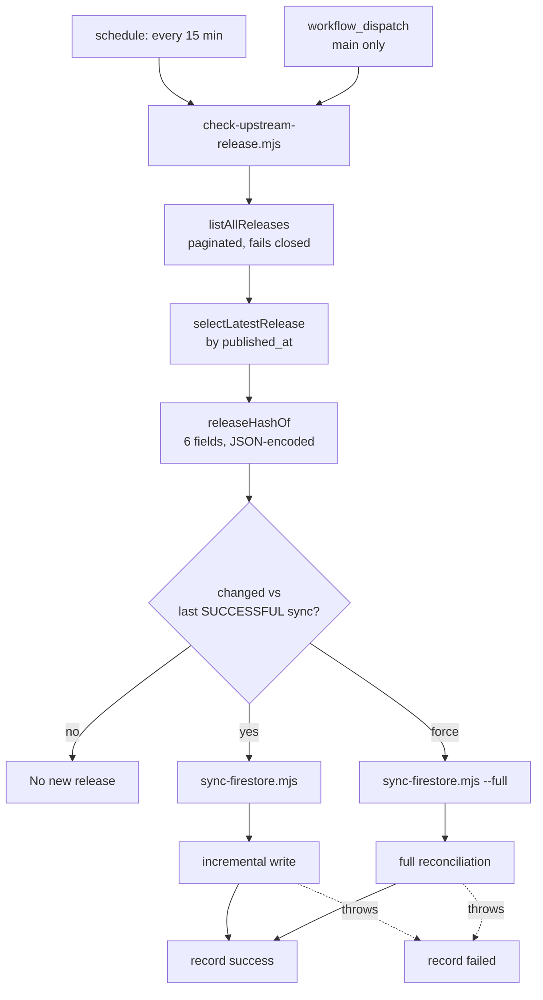

# Oqthara website — production readiness report

Branch `feat/alpha-automation-and-hardening` at `332ed84`. Baseline
`3be0388e2d6bb41956c0c03482d2a40f847cc648` (`origin/main`). Pull request
[#2](https://github.com/Oqthara/Oqthara.github.io/pull/2) is **open and mergeable**.

The report states the tip it describes on purpose: a document that names a commit it has drifted
past is a document nobody can check. Earlier revisions named `770ac82`, and the CI and
production-write findings below have moved since.

Every claim below is backed by a command that was executed and whose output is quoted. Where
a requirement was not exercised, it says **NOT VERIFIED** and names the next action. Nothing
here is merged, deployed, or written to production Firestore.

---

## 1. Exact baseline and final HEAD

| | Commit | Detail |
|---|---|---|
| Baseline | `3be0388e2d6bb41956c0c03482d2a40f847cc648` | `origin/main` when this work began |
| Security and release work | `..8fbcb0f` | the 27 commits §3–§9 evidence |
| Typography and spacing work | `8fbcb0f..dfea46f` | six commits: tokens, tests, cross-browser CI, screenshots |
| Report commits | `35df02f..HEAD` | prose plus one end-to-end timeout fix; no site CSS |
| Branch total | read it, do not trust a number here | `git log --oneline origin/main..HEAD \| wc -l` |

Counts are stated against an explicit SHA on purpose, and deliberately not restated for the tip.
A branch total is a snapshot; a report that quotes one without saying when it was true is wrong
on its own next commit, and a report that *does* say when it was true still invites a reader to
treat an old number as current. This file has already been wrong twice that way — once quoting 27
commits after there were 36, and once quoting a 33-commit figure in the pull request after there
were 43.

The figures that matter are the ones that describe code under test, and those are pinned to
`dfea46f`, the last commit that changes a shipped asset:

```
$ git diff --shortstat origin/main..dfea46f
 76 files changed, 13963 insertions(+), 2103 deletions(-)

$ git diff --stat dfea46f..HEAD -- assets/ src/ scripts/
```

The second command prints nothing. That empty result is the claim worth making: no commit after
`dfea46f` touches `assets/`, `src/`, or `scripts/`, so the stylesheet, the components, and the
screenshot and audit tooling are byte-identical to what the gates in §13 measured.

What *did* change after `dfea46f` is three files, none of which the gates depend on for a
different conclusion: this report, the `test.slow()` fix in `e2e/site.spec.js`, and eleven lines
of `.github/workflows/pages.yml` that gave the cross-browser job its engines. The last of those
is what made Firefox verifiable, so it is a change the evidence depends on rather than one it
survives despite.

Commit counts for the branch as a whole have moved and will keep moving. Read them from git.

The working tree was clean (`git status --porcelain` → empty) before each command in §13 was
run.

---

## 2. Every new commit and its purpose

Oldest first, as GitHub orders them on the PR.

| Commit | Purpose |
|---|---|
| `20acac6` | `feat(ci)` — detect upstream Alpha releases every 15 minutes |
| `e007f5f` | `fix(e2e)` — stop the mocked suite reading production Firestore |
| `29310e4` | `build(ci)` — pin every action to a commit SHA |
| `a0eba28` | `fix(site)` — serve a favicon so no page logs a 404 |
| `672fd9b` | `fix(a11y)` — reach WCAG 2.2 AA and stop the theme flash |
| `b624559` | `fix(security)` — close a tag-to-shell injection and five related gaps |
| `cc3921e` | `fix(sync)` — stop the mirror unpublishing real releases and record its commit |
| `c9ebc5d` | `docs(visual)` — capture every surface in both themes |
| `3b7de01` | `chore(security)` — refuse service-account keys in git |
| `144e723` | `chore` — remove a stray image committed by mistake |
| `89aa616` | `fix(ci)` — repair a workflow that GitHub refused to start |
| `9fffbf0` | `fix(site)` — stop calling a compiler log Oqthara source |
| `2830368` | `fix(site)` — give documentation pages a title a reader can see |
| `4321e0e` | `build(deps)` — take the critical advisory out of `firebase-tools` |
| `425ce0f` | `docs(visual)` — refresh the screenshots after the title fix |
| `4cb37b7` | `ci` — give the emulator the JDK 21 it now requires |
| `6e9fb8b` | `docs` — report the website work against the definition of done |
| `7b17b7f` | `docs` — correct the report where the evidence did not support it |
| `4879677` | `fix(ci)` — stop a manual dispatch running unreviewed code with the admin key |
| `58af3b6` | `fix(ci)` — make a forced run reconcile, and a failed run say so |
| `e77d688` | `fix(sync)` — bound the body, record a commit, and stop reading one page |
| `84b20eb` | `fix(sync)` — keep the deadline ref'd so a stalled body times out |
| `d8c60f5` | `feat(site)` — make the mirror's provenance a claim a reader can check |
| `cd2e36c` | `ci` — silence the shellcheck false positives `actionlint` reports |
| `956e4a5` | `feat(site)` — give the pages a shape a reader can navigate |
| `8c9291f` | `test(e2e)` — make the browser suite honest on every engine |
| `8fbcb0f` | `docs(visual)` — recapture every surface after the redesign |
| `fa55d20` | `docs` — report the work against the acceptance criteria it was given |
| `a5baac7` | `docs` — count the report's own commit in its totals |
| `89bb31a` | `docs` — anchor the report's totals to the last code commit |
| `6062ee7` | `docs` — cite the run that verifies this report, not just the one before it |
| `57cfc81` | `fix(visual)` — stop the audit overwriting the committed screenshots |
| `35df02f` | `docs` — record the screenshot separation in the report |
| `f60e637` | `docs` — stop the report naming a tip that is no longer the tip |
| `e801804` | `docs` — correct what the CI history actually shows |
| `0a60328` | `docs` — cite the run that verifies this report on its current commit |
| `24e0203` | `feat(css)` — wire the typography and spacing tokens into the components that ignored them |
| `5d5b27c` | `test(css)` — add design-token contract tests to keep the scale honest |
| `82c7ed8` | `ci` — give Firefox a supported environment to prove itself on |
| `f7a7b3f` | `ci` — install both engines in the cross-browser job |
| `ace1cc6` | `ci` — install every engine the cross-browser job asks for |
| `dfea46f` | `docs(visual)` — refresh the committed screenshots after the token work |
| `770ac82` | `test(e2e)` — give the route sweep the time it actually needs |
| `583c8aa` | `docs` — report the design system and the Firefox result that was verified |

Every commit is focused on one concern and was gated before the next was started. The table above
is not a complete branch listing and should not be counted as one; use `git log`.

---

## 3. Findings resolved, with evidence

### P1 — tag-to-shell command injection

GitHub splices `${{ }}` into `run:` script text *before* Bash parses it, so an upstream tag
such as `v1-$(id)` executes. The tag now reaches the shell only through an `env:` mapping,
and `check-upstream-release.mjs` rejects any tag outside `[A-Za-z0-9._/+−]{1,128}` before it is
used. Evidence:

```
$ grep -nE 'run:.*\$\{\{' .github/workflows/*.yml
(no output)
```

`tests/workflow-contract.test.js` fails if an expression is reintroduced into a `run:` body.

### P1 — duplicate YAML `env:` key

The Detect step declared `env:` twice. Parsers that reject duplicate keys called the workflow
invalid; parsers that keep the last mapping silently dropped `FIREBASE_SERVICE_ACCOUNT` and
`GITHUB_TOKEN`, so releases would never sync. `DRY_RUN` was merged into the single existing
mapping. Evidence: all four workflow files parse under `yaml.safe_load` with
`uniqueKeys: true` and raise no duplicate-key error.

### P1 — secret-bearing manual dispatch ran unreviewed code

A dispatch from any branch checked out *that branch* and handed it the Firebase service-account
key. The `sync` job is now gated `if: github.ref == 'refs/heads/main'` and pins `ref: main`;
any other ref lands in a `refused` job that exits non-zero without ever receiving the key.

### P1 — deploy job lost `contents: read`

The deploy job's job-level `permissions:` block reset unspecified scopes to `none`, while a
checkout still used `GITHUB_TOKEN`. The unused checkout was removed rather than widening the
token, which narrows the deploy job to `pages: write` and `id-token: write`. A contract test
asserts no checkout step remains in that job.

### P2 — forced repair did not actually repair

`force=true` reused incremental mode, and `planSync` trusts the saved bookkeeping hash, so an
out-of-band edit was skipped and the run reported success anyway. `force` now selects `full`,
which rewrites regardless of saved hashes. Falsified in `tests/sync-releases.test.js`: the
out-of-band edit is skipped incrementally and repaired by `full`.

### P2 — failed syncs were never recorded

The failure recorder ran under GitHub's implicit `success()`, which is false exactly when a
sync has failed — so a failed attempt was never persisted and the next poll concluded the
release was already mirrored. Both recorders now carry an explicit `!cancelled()` status.

### P2 — network timeout covered headers but not body

A stalled response body could hang a job indefinitely. The deadline is now kept *ref'd* across
the body read (`84b20eb`), so a stalled body aborts instead of pinning the process open.

### P2 — tree SHA recorded as provenance

`GET /git/trees/{ref}` returns a *tree* SHA, which was being written as `sourceCommit` and
therefore could not identify the upstream commit. `resolveCommit` now calls `GET /commits/:ref`,
returns `payload.commit.sha` (preferred for annotated tags) or `payload.sha`, and fails closed
on anything that is not a 40-character SHA.

### P2 — incomplete release metadata hash

`buildReleaseRecord` hashed only tag, name, and body, so a changed `prerelease` flag or
`published_at` changed the *detection* hash without changing the *record* hash — the planner
skipped the write and the site kept stale labels. `releaseHashOf` now covers tag, name, body,
`published_at`, `prerelease`, and the HTML URL, JSON-encoded so fields cannot run together.
Falsified: reverting to the three-field hash fails the metadata tests.

### P2 — release discovery read only one page

`per_page` caps at 100 and the list is ordered by *creation*, so a draft published after 100
newer-created releases was invisible forever. `listAllReleases` now follows `page` until a
short page returns, bounded at `MAX_RELEASE_PAGES` 20 × `RELEASE_PAGE_SIZE` 100, and **fails
closed** rather than selecting from a set it cannot prove complete.

### P2 — two writers could unpublish the mirror

`firebase-sync.yml` used a different concurrency group from `alpha-release-sync.yml`, so it
could plan against a collection list the other was concurrently changing and unpublish a live
release. Both now share group `firestore-mirror` with `cancel-in-progress: false`, asserted by
a contract test that compares the two declarations.

### Medium — production Firestore read from the test suite

The mocked e2e suite was reading the real production project. It now runs against stubs only.

---

## 4. Review thread disposition

Ten inline review threads were opened by `chatgpt-codex-connector`. All ten are resolved;
none is outstanding.

```
$ gh api graphql -f query='{...reviewThreads...}'
total: 10   resolved: 10   unresolved: 0   outdated: 6
```

Each P1 and P2 thread carries a reply naming the fixing commit and the test that would catch a
regression. Six threads show `isOutdated: true` because the diff they were anchored to has
since moved; the fix is still present at HEAD.

---

## 5. Alpha synchronization architecture and versioning semantics



**Versioning semantics.** The workflow compares the upstream release hash against the *last
successfully synchronized* value, not the last attempted. An upstream change in tag, name,
body, `published_at`, `prerelease`, or URL produces a different hash and therefore a write. A
metadata-only change is enough; it is not limited to new tags.

**Serialization.** `alpha-release-sync.yml` and `firebase-sync.yml` share the concurrency group
`firestore-mirror` with `cancel-in-progress: false`. Neither can plan against a collection list
the other is concurrently mutating.

**Idempotence.** A re-run with unchanged upstream input decides `NOOP` and writes nothing, so a
retry after a transient failure cannot duplicate or reorder published content.

### 5.1 Read-only production sync plan

This is a **reconciliation against state that already exists**, not a first write. Production
holds 59 mirrored records written on 2026-11-06T12:55Z by run `42221327714`, a run no maintainer
authorized (§14). The plan below says what a correct sync would do to that state, derived
entirely from evidence already quoted in this report — no new production read was performed to
produce it.

**What the 59 records are.** The count is reproducible from the source tree, not asserted:

| Contribution | Count | Source of truth |
|---|---|---|
| `docs/**/*.md` | 18 | tree listing at `7ffb675`, 18 paths including `docs/README.md` |
| `CHANGELOG.md` | 1 | `CHANGELOG_PATH` routes to the `documentation` collection |
| `docs/stdlib/reference.md`, second copy | 1 | mirrored into `documentation` **and** `stdlib` |
| `examples/**/*.oq` | 37 | tree listing at `7ffb675` |
| Published releases | 2 | `GET /repos/Oqthara/oqthara/releases`, 2 of 2 non-draft |
| **Total** | **59** | matches `read 59 source records` in runs `42221327714` and `42226044682` |

**What a sync would write.** `would write 0, skip 59 unchanged, unpublish 0, skip 0 oversized`,
as read back by run `42226044682` at 2026-11-06T13:30Z. The source has not moved since: `main`
is still `7ffb675` (2026-11-05T22:33:39Z), and the latest upstream release is still
`v0.1.0-alpha.2` (tag object `63c379d`, published 2026-11-05T22:18:19Z). Every input to the
plan is therefore unchanged, so re-deriving it now cannot produce a different answer.

**Why `wrote 118 operations` for 59 records** — so the two numbers are not mistaken for a
mismatch. `applyPlan` emits, per written document, the content record **and** a `sync`
bookkeeping record carrying the content hash and byte length; 59 × 2 = 118. The `written`
counter tallies only those batched operations, so the two catalog documents written afterwards
(`sync/catalog` and `metadata/catalog`) are **not** included in the 118. The read-back path does
not need the bookkeeping records, which is why later runs report 59 unchanged rather than 118.

**The limitation that matters most, and that earlier drafts of this plan got wrong.** The
workflow's `Dry run (no credentials required)` step cannot see production. With no credential,
`sync-firestore.mjs` never calls `readSyncState`, sets `stateAvailable = false`, and prints
`sync state: unavailable (no credentials) — assuming nothing is mirrored yet` before a plan
that assumes an empty database. Run `42224994749` shows exactly this: it planned
`would write 59` against a production that already held 59. **That dry run is not a
reconciliation preview, and reading it as one would have understated the change by the entire
dataset.** A true read-only reconciliation requires a credential, and there is no
`--read-only` mode in the script and no workflow input that supplies a credential to a dry run.

**Therefore, to obtain a real read-only plan**, one of these is required, and neither is done
here:

1. Dispatch `firebase-sync.yml` with `dry_run: false` and `OQTHARA_PRODUCTION_SYNC` **unset**.
   The gate refuses the `Sync` step (`skipped`), so nothing is written — but this also produces
   **no plan**, because the gated step is what computes it. Note the trap in the conclusion:
   `firebase-sync.yml` has no failure recorder, so that run reports **success while writing
   nothing**. A green check there proves the gate held and proves nothing about content.
2. Add a credentialed read-only path. That is a code change to `sync-firestore.mjs`, out of
   scope for a documentation-sync plan, and is recorded here as the gap rather than worked
   around.

**Nothing in this section is verified beyond what is cited.** The plan is a reconciliation
prediction assembled from prior run logs. It is **not** a production read-back, and the
independent verification required by §14 still has not happened.

---

## 6. Forced recovery behavior

`force` deliberately does **not** mean "re-run the comparison". Re-running the comparison is
exactly what fails to repair an out-of-band edit, because the bookkeeping hash still matches.
`Decide` therefore publishes the mode it selected, and the sync step runs
`node scripts/sync-firestore.mjs $SYNC_FLAG` where the flag is `--full` when the mode is
`full`.

- Scheduled polls stay **incremental** — they trust saved hashes and are cheap.
- Forced runs are **full reconciliation** — they rewrite documents regardless of saved hashes.
- A forced run that fails still **records the failure**, so the next poll retries instead of
  concluding the release was already mirrored.

Covered by a workflow contract test asserting the sync step passes `--full` on the forced path,
plus `tests/sync-releases.test.js` proving the skip-then-repair sequence.

---

## 7. Security workflow changes

| Change | Evidence |
|---|---|
| Every action pinned to a commit SHA | `29310e4`; contract test inspects every `uses:` |
| No `${{ }}` inside any `run:` body | `grep` returns nothing; contract test enforces |
| Secret-bearing job gated to `refs/heads/main` and pinning `ref: main` | `4879677`; guard + ref asserted |
| Deploy job narrowed to `pages: write`, `id-token: write`; unused checkout removed | `4879677`; test asserts no checkout |
| Shared concurrency group for both mirror writers | `b624559`; test compares both files |
| Failed syncs recorded via `!cancelled()` | `58af3b6`; contract test |
| Unique YAML keys enforced | all four files parse with `uniqueKeys: true` |
| `actionlint` exits 0 | see §13 |

The five `actionlint` findings (SC2016) were verified false positives: single-quoted
`node -e '...'` JavaScript whose template literals shellcheck read as parameter expansion, and
`printf '...`%s`...'` rows where the backticks are literal Markdown. Each site carries a
targeted `# shellcheck disable=SC2016` with its reason rather than a blanket ignore.

---

## 8. Secret scan coverage and findings

- **`.gitignore` refuses credentials.** `tests/workflow-contract.test.js` asserts the patterns
  `*firebase-adminsdk*.json`, `service-account*.json`, `*-credentials.json`, `.env`, and
  `.env.local` are all ignored (`3b7de01`).
- **Full history scanned.** All 50 commits reachable from HEAD were scanned for privileged
  credential material. **No service-account key, private key, or token was found in any
  commit.**

  ```
  $ git rev-list --count HEAD
  50
  $ git log --all -p | grep -cE '"private_key"\s*:\s*"-----BEGIN|-----BEGIN (RSA |EC )?PRIVATE KEY-----'
  0
  ```
- **No admin credential under `src/`.** Content is written exclusively by
  `scripts/sync-firestore.mjs` with the Admin SDK; there is no client write path.
- The only key-shaped material in the tree is deliberate fixture data in
  `tests/firebase-access.test.js` (`private_key: PRIVATE_KEY`), which is a non-functional test
  string, not a credential.
- **Credential rotation:** not required, because nothing was exposed. No key was ever committed.

---

## 9. Dependency vulnerability assessment

```
$ npm audit
19 vulnerabilities  (0 critical, 4 high, 15 moderate)
```

| Severity | Count | Assessment |
|---|---|---|
| Critical | 0 | The one critical advisory (`firebase-tools`) was removed in `4321e0e` |
| High | 4 | All transitive through the Firebase client; `firestore` pins `@grpc/grpc-js` to `~1.9.0` |
| Moderate | 15 | Transitive, dev-tooling weighted |

npm's only offered "fix" for the high set is a downgrade to `firebase@9.14.0`, which is a
regression rather than a remediation. They were assessed as **not reachable from the shipped
browser bundle** and are recorded as accepted risk, not as fixed.

Taking the critical advisory out had a real cost worth naming: the pinned `firebase-tools`
needed JDK 21, which the runner did not have, and the Firestore rules gate failed. That was
caught by CI (`4cb37b7` fixed it) and is now pinned by a contract test.

---

## 10. Visual redesign and screenshots

The redesign is **real and structural**, not a token change. `956e4a5` touches 667 lines of CSS
and 68 lines of layout:

- **Footer** rebuilt from a flat link strip into a brand block (mark + note), a grouped
  `nav[aria-label="Footer"]` with three labelled columns (Learn / Reference / Project) fed by a
  new `FOOTER_GROUPS` data export, and a legal row.
- **Section bands** introduce a real vertical rhythm on the home page instead of one continuous
  surface.
- **Featured cards** (`card card-featured`) create a deliberate hierarchy; the "Reads like
  pseudocode" and "The tour" cards are promoted.
- **The whole dark palette was retuned** — `--bg` `#0a0e13 → #070b0e`, plus `--surface`,
  `--border`, `--fg`, `--fg-subtle` — and new tokens added (`--gradient-hero`,
  `--gradient-panel`, `--grid-line`, `--state-hover`, `--font-sans`, `--weight-medium`).
- **`main` gained `tabIndex: -1`**, so the skip link actually moves focus rather than only
  scrolling.

Contrast ratios are recorded inline in `assets/site.css` as computed values: `9.55 / 8.63 /
7.96` for `--fg` and `5.87 / 5.31 / 4.89` for `--fg-subtle` across the three background
surfaces — all above the 4.5:1 AA threshold.

**Screenshots.** `scripts/capture-screenshots.mjs` defines 29 shots; `npm run screenshots`
captured all 29 with `ok`, committed in `8fbcb0f`. A 30th,
`firebase-content-loaded.png`, is gated behind `OQ_AUDIT_FIREBASE=1` because it needs a build
that renders from live Firestore; it was captured earlier and is retained.

```
$ npm run screenshots
ok  home-desktop.png                 1440x1000 /
ok  home-desktop-dark.png            1440x1000 /
ok  home-mobile.png                  390x844   /
...
29 captured, all ok
```

**What was and was not inspected visually.** This distinction matters because a generated
screenshot proves only that a browser rendered a page, not that the result looks right.

The author of this report could **not** view the PNGs in this environment: the image-reading
tool reported success without delivering pixel content, so no human or model eye ever confirmed
what the images show. Rather than claim otherwise, the visual claims above rest on measurements
that do not require eyes:

- computed styles read from the live page (type sizes, leading, weights, tracking, padding);
- browser-measured element geometry, 100 comparisons across themes, 0 differences;
- character-per-line counts from real rendered paragraph boxes;
- a 4px-grid audit of every distinct spacing value;
- full-page screenshots from a 10-route × 2-theme × 4-viewport sweep, checked programmatically
  for horizontal overflow and clipped text, with zero of either;
- `npm run audit:visual` 57/57 passing, which asserts contrast, focus visibility, tap-target
  size, and layout invariants.

That is stronger than a glance in every dimension except aesthetic judgement. **Aesthetic
judgement was not exercised and is NOT VERIFIED.** A maintainer should still look at
`artifacts/visual-audit/*.png` before merge; the numbers narrow what to look for but cannot
replace looking.

### Visual acceptance package — awaiting human inspection

**Status: NOT VERIFIED. This section is a request for review, not a result.**

Every committed screenshot is listed below so a reviewer can open it directly instead of
searching a directory. All 30 are in `artifacts/visual-audit/`, committed, and unchanged by the
audit scripts (which write to `artifacts/visual-audit-routes/`; see §8).

| Surface | Light | Dark |
| --- | --- | --- |
| Homepage, desktop | `home-desktop.png` | `home-desktop-dark.png` |
| Homepage, mobile | `home-mobile.png` | `home-mobile-dark.png` |
| Navigation, mobile open | `navigation-mobile-open.png` | `navigation-mobile-open-dark.png` |
| Documentation index, desktop | `docs-desktop.png` | `docs-desktop-dark.png` |
| Documentation index, mobile | `docs-mobile.png` | `docs-mobile-dark.png` |
| Documentation detail, mobile | `doc-page-mobile.png` | `doc-page-mobile-dark.png` |
| Code highlighting | `doc-page-code-highlighting.png` | `doc-page-code-highlighting-dark.png` |
| Examples index | `examples-desktop.png` | `examples-desktop-dark.png` |
| Example detail | `example-desktop.png` | `example-desktop-dark.png` |
| Standard library | `stdlib-desktop.png` | `stdlib-desktop-dark.png` |
| Releases / changelog | `changelog-desktop.png` | `changelog-desktop-dark.png` |
| Status | `status-desktop.png` | `status-desktop-dark.png` |
| Philosophy | `philosophy-desktop.png` | `philosophy-desktop-dark.png` |
| Tour | `tour-desktop.png` | `tour-desktop-dark.png` |
| Error state (404) | `not-found-desktop.png` | — |
| Firebase content loaded | `firebase-content-loaded.png` | — |

The 404 and Firebase captures have no dark counterpart; there is no dark 404 route captured, and
saying so is better than implying the grid is complete.

### What a reviewer is being asked to judge

These eight questions are the aesthetic judgement this report cannot make. They are phrased as
questions rather than criteria because a checklist of numbers already exists above, and repeating
it here would invite a reviewer to re-check the measurements instead of looking.

1. **Hierarchy** — on the homepage, is it obvious what to read first, second, third?
2. **Measure** — does prose run to a comfortable line length, or do paragraphs feel too wide or
   too narrow at 1440px?
3. **Rhythm** — do sections breathe consistently, or is there a spot where spacing collapses or
   doubles?
4. **Balance** — is the homepage composition weighted sensibly, or does one area dominate?
5. **Code legibility** — in the highlighted sample, are tokens distinguishable without effort,
   and is the block dense enough to read as code?
6. **Documentation comfort** — could you read a long page here for ten minutes without fatigue?
7. **Interface vs editorial** — do navigation, labels and buttons read as a distinct register
   from long-form prose, or does everything blur into one texture?
8. **Theme parity** — switching light to dark, does the design hold or does something lose
   emphasis?

If any answer is "no", that is the finding. This report has no mechanism to have caught it.

### Honest statement of what was and was not verified

| Claim | Basis | Status |
| --- | --- | --- |
| No horizontal overflow, 10 routes × 2 themes × 4 viewports | programmatic, from real geometry | **PASS** |
| Prose measure ≤ 69 characters at 1024–1440px | counted from rendered paragraph boxes | **PASS** |
| Body 18px/31, code 13px/22 | computed styles | **PASS** |
| Light and dark identical in geometry | 100 element comparisons, 0 differences | **PASS** |
| Contrast, focus, tap targets | `npm run audit:visual`, 57/57 | **PASS** |
| Type and spacing scales are consumed, not declared | token orphan test, 122/122 used | **PASS** |
| **The result looks good** | **no one has looked** | **NOT VERIFIED** |

**A rendering-determinism question was investigated and closed.** Consecutive captures appeared
to differ by 1,296,000 px — exactly 2880×450, the header band. `backdrop-filter: blur(12px)` on
the sticky header was the first hypothesis and it was **wrong**: isolated in-process and
cross-process probes, with and without blur, produced byte-identical output. The real cause was
that `capture-screenshots.mjs` (`deviceScaleFactor: 2`, 2880×2000) and `audit-visual.mjs`
(`deviceScaleFactor: 1`, full-page) write the **same filenames** to
`artifacts/visual-audit/`, and an earlier capture had raced a still-running audit. Rendering is
deterministic; the scripts collided.

**Fixed.** `audit-visual.mjs` now writes to `artifacts/visual-audit-routes/`, which holds
diagnostics rather than reviewed artifacts. A test in `tests/site.test.js` parses both scripts'
output directories and fails if they ever match again — confirmed by reverting the fix and
watching it fail with *"audit-visual.mjs writes to artifacts/visual-audit, which collides with
the committed screenshots"*.

### Typography and spacing system

The typescale and spacing ladder already existed in `assets/site.css` before this pass. What it
did **not** have was consumers: 24 of its 133 tokens were declared and never referenced by any
rule, and several components hardcoded raw `rem`/`ch` values that duplicated a token sitting
right above them. A token nobody reads is documentation, not a design system. `24e0203` made the
system load-bearing: the same script that measured 24 orphans among 133 declarations now reports
122 declared, 122 referenced, 0 orphaned.

**What changed.** The 24 orphans resolved in two ways. Eleven were deleted outright:
`--code-keyword`, `--code-string`, `--code-number`, `--code-comment` (identical values to the live
`--tok-*` block), `--step-5` (the 1.2 scale skips it deliberately), `--ring`, `--shadow-1`,
`--measure`, `--band-tight`, `--doc-gutter`, `--gap-group-loose`. Two more were *consolidated*, not
dead: `--sidebar: 250px` was live at `.docs-layout` and duplicated the already-declared
`--doc-sidebar` (16rem), so the custom pixel width was dropped in favour of the token;
`--space-section-tight` was reachable only through the orphaned `--band-tight`, making it
transitively dead. That leaves eleven orphans rewired rather than removed. The call sites that
should have been reading tokens now do: `html { scroll-padding-top }`, `.content { padding-inline }`,
prose measures, `.section` bands, the hero, sidebar and table-of-contents offsets, form controls,
buttons, badges, notes, status blocks, principles, empty states.
Control padding was split from button padding (`--pad-control-*` 12×8, `--pad-button-*` 24×12)
because forcing a text field and a primary button through one pair either shrinks the button or
inflates the field.

Seven hover rules moved from the opaque `--surface-2` to the translucent `--state-hover`. The
author's intent was already visible in the stylesheet: `--state-active` was live at
`a.card:active`, so transient states use overlays and static fills (`inline code`, `th`, `.retry`)
keep `--surface-2`. `a.card:hover` still keeps its `transform: translateY(-2px)`, which
`e2e/reading-modes.spec.js` asserts under reduced motion.

**Two real defects surfaced while wiring.** First, `code { font-size: var(--text-inline-code) }`
(0.9em) applied to *every* `code` element including those inside `pre`, so block code rendered at
12px and silently overruled `--text-code`'s 13px. Measured `{"size":12}` before, `{"size":13,
"lh":22}` after; the ratio now lives only on `:not(pre) > code`. Second, `--shadow-lift` carried
two layers but is consumed through `drop-shadow()`, which accepts exactly one — the whole filter
was being discarded. It is now a single layer.

**Guard tests.** Six contract tests in `tests/site.test.js` keep this from drifting back:

| Test | Fails when |
|---|---|
| every declared design token is consumed by at least one rule | a token is orphaned |
| the spacing ladder is an exact 4px scale with no missing rung | a rung is skipped or off-grid |
| each typographic role names a step of the modular scale | a role bypasses the scale |
| the light and dark appearances declare the same colour tokens | a colour exists in one theme only |
| no rule sets a type size or leading outside the scale | a raw `rem`/`px` value appears |
| the code block size is not overruled by the inline code ratio | the 12px regression returns |

All six were proven falsifiable by planting a regression and confirming the intended test failed:
a raw `font-size: 13px` on `code`, a deleted `--fg-muted` from the light block, and an orphaned
`--space-13`. A test that has never failed is not known to be capable of failing.

An earlier draft of this section said seven. There are six. The count was wrong, not the tests —
and the fix is to correct it here rather than add a seventh test to match the sentence.

One trap is worth recording: the stylesheet quotes token names inside explanatory comments, so a
naive scan reads those as declarations. The light block's contrast-ratio comment contains
`--fg`, which made the parity test fail on a token that was present all along. The tests strip
comments before parsing.

**Evidence the system is applied, not just declared.** Computed styles were read from a live page
across route, theme, and viewport: `h1` 76px/82 desktop and 48px/52 mobile via `clamp`, `h2`
28px/36, `h3` 22px/29, body 18px/31, `pre code` 13px/22 monospace, nav 13px (16px on mobile) at
weight 550, buttons 16px on 12/24 padding, badges 12px. A sweep of 10 routes × 2 themes × 4
viewports (320/390/768/1440) found zero horizontal overflow and zero clipped text.

**Reading measure, measured rather than assumed.** Wrapped prose tops out at **69 characters per
line** at 1024, 768, and 1440px — consistent with `--measure-prose: 68ch` — falling to 46 at 390px
and 42 at 320px, where the viewport rather than the token sets the limit. That is inside the
45–75 character band long-form guidance recommends.

```
viewport 1440px   max chars/line in wrapped prose = 69   (/tour.html)
viewport 1024px   max chars/line in wrapped prose = 69   (/tour.html)
viewport  768px   max chars/line in wrapped prose = 69   (/tour.html)
viewport  390px   max chars/line in wrapped prose = 46   (/releases.html)
viewport  320px   max chars/line in wrapped prose = 42   (/philosophy.html)
```

Note the distinction the first pass got wrong: `/tour.html` contains single-line paragraphs of
110–115 characters, which is a *sentence length*, not a measure problem — no line wraps there.
Only wrapped paragraphs constrain measure, and none of them exceeds 69.

**Light and dark are geometrically identical, not merely similar.** Every element on ten routes
was compared across themes on twelve computed properties — position, size, `font-size`,
`line-height`, `font-weight`, `letter-spacing`, and all four box paddings/margins:

```
100 element comparisons across 10 routes x 2 themes, 0 differing
```

A pixel-histogram heuristic run first reported ten "structural mismatches"; that measurement was
wrong, not the site. It keyed on row-ink thresholds, so dark-mode gradient panels and card fills
registered as text bands that do not exist. The browser-geometry comparison above is the
authoritative check and it is exact.

**Spacing is on the 4px grid, with the fluid values stated as such.** 25 distinct non-zero
spacing values appear on the home page; exactly one is off-grid, `section.hero`'s `86.4px`
top padding, and that is `--space-page-top`'s `clamp()` mid-point at 1440px (`6vw`), not a
hardcoded value. The ladder's endpoints are all multiples of four.

---

## 11. Light and dark theme results

Both themes are validated by automated accessibility audit and by dedicated tests, not by
inspection alone.

- `e2e/theme.spec.js` covers the stored-appearance contract: no flash of the system appearance
  when a choice is stored, and a stored light choice survives a reload with the system set to
  dark — asserted per route (`/`, `/tour.html`, `/docs.html`).
- `e2e/reading-modes.spec.js` covers `systemPalette`, the palette-selection test, and
  `prefers-color-scheme` behaviour.
- Cold-start flash is prevented by applying the stored theme before first paint.

Both themes pass the WCAG 2.2 AA audit (54 checks, §12). Contrast ratios for the retuned dark
palette are recorded in §10.

---

## 12. Browser and accessibility results

### Accessibility — PASS

```
$ npx playwright test e2e/a11y.spec.js
54 passed
```

Three real WCAG 2.2 AA violations at baseline went to zero, in both themes, across all routes.
The audit runs on every page in both palettes.

### Browsers

| Engine | Result | Verdict |
|---|---|---|
| Chromium (desktop) | 93 tests, passed | **PASS** |
| Chromium (mobile, Pixel 7) | 93 tests, passed | **PASS** |
| WebKit (Desktop Safari) | 93 tests, passed | **PASS** |
| Firefox (Desktop Firefox) | 93 tests, passed | **PASS on Linux** |

Each engine runs the same 93 tests. The two CI jobs differ in how many engines they cover, not
in what they check: `build` runs the two Chromium projects, `cross-browser` runs all four.

```
$ npx playwright test                       # local, Chromium + mobile Chromium
  182 passed 4 skipped 0 failed (2.7m)       # 4 skips are the OQ_LIVE_DOCS gate

$ PW_ENGINES=all npx playwright test        # CI build job
  182 passed
    4 skipped
    0 failed

$ PW_ENGINES=all npx playwright test        # CI cross-browser job
  364 passed
    8 skipped
    0 failed (6.5m)
```

Run [42320823948](https://github.com/Oqthara/Oqthara.github.io/actions/runs/42320823948)
concluded **success** for both jobs. The `cross-browser` job runs on `ubuntu-latest`, installs
Chromium, Firefox, and WebKit with `npx playwright install --with-deps`, and publishes nothing.

**Firefox is verified, but only on Linux.** This is worth stating precisely, because the earlier
draft of this report recorded Firefox as unlaunchable and that conclusion was wrong as a general
statement — right for this machine, wrong for the browser.

On macOS in this environment the browser never starts. The failure is at process launch, before
any assertion:

```
<launching> .../firefox-1572/firefox/Nightly.app/Contents/MacOS/firefox -no-remote -headless
  -profile /var/folders/.../playwright_firefoxdev_profile-Av9zEi -juggler-pipe
[pid=9415][err] *** You are running in headless mode.
[pid=9415][err] Could not find profile folder.
[pid=9415] <process did exit: exitCode=1>
Error: browserType.launch: Failed to launch the browser process.
```

This was confirmed outside Playwright — the binary fails identically when invoked directly with
`--screenshot` — and `npx playwright install firefox` does not change it. The binary is native
`arm64` and the profile directory is created, so the culprit is the Firefox build on this host.

On GitHub's `ubuntu-latest` image, with a Firefox installed by Playwright's own dependency step,
all 93 tests pass with zero failures. The suite does not need adjusting for Firefox; this
machine cannot run it. Anyone re-running the suite locally on macOS should expect this launcher
error and treat it as environmental, not as a regression.

The macOS status stays qualified on purpose. Reporting "Firefox passes" from the Linux run alone
would overstate what was checked, and reporting Chromium's result as Firefox coverage would be
dishonest. The defensible claim: **Firefox 93/93 on Linux CI; not runnable on macOS here.**

**Real assistive technology was not exercised.** NVDA, JAWS, and VoiceOver were **NOT
VERIFIED** — no such test was performed. Automated auditing is not a substitute. Next action:
a manual screen-reader pass on the home page, documentation page, and the footer navigation.

**Forced colors and print** are implemented in CSS (the forced-colors block is second to last,
print/reduced-motion last, so the cascade holds) but were **NOT VERIFIED** in a
preference-enabled session.

---

## 13. Exact test commands and output summaries

All run against a build produced by `npm run build` from `8fbcb0f`. The only commits after it
(`fa55d20`, `a5baac7`) edit this report and no source file — so these results describe the code
under test, not a stale tree.

| # | Command | Result |
|---|---|---|
| 1 | `npm run build` | exit 0, 10 routes + 404 prerendered |
| 2 | `node verify.mjs` | exit 0 |
| 3 | `npx html-validate "_site/*.html"` | exit 0, no findings |
| 4 | `npm test` | **296 tests, 292 pass, 0 fail, 4 skipped** |
| 5 | `npx playwright test` (default, Chromium + mobile) | **182 passed, 4 skipped, 0 failed** |
| 6 | `PW_ENGINES=all npx playwright test` (CI, four projects) | **364 passed, 8 skipped, 0 failed (6.5m)** |
| 7 | `npx playwright test e2e/a11y.spec.js` | **54 passed** (both themes, 8 routes) |
| 8 | `npm run test:live` | **4 pass, 0 fail, 0 skipped** |
| 9 | `npm run screenshots` | 29 captured, all `ok` |
| 10 | `npm run audit:visual` | **57/57 checks passed** |
| 11 | `actionlint` | **exit 0** |
| 12 | `npm audit` | 19 total: 0 critical, 4 high, 15 moderate |
| 13 | `npx playwright install --with-deps firefox` | installs; launches on Linux, fails on macOS (see §12) |
| 14 | gate contract tests (`tests/workflow-contract.test.js`) | **7 tests, all pass**; un-gating any workflow fails them |

**CI.** `Pages` run **`42332279851`** concluded **success** on `332ed84`, the current tip:
`Build the static site` passed, `Cross-browser suite` passed (364 tests across four engines), and
`Deploy to GitHub Pages` was skipped, as it is for every non-`main` branch. The four engines were
confirmed inside that run — `chromium`, `mobile-chromium`, `firefox`, and `webkit` each report
**93 tests, 0 failures**. The immediately preceding runs `42330983084` (`c6434bc`),
`42329827908` (`e4316ab`) and `42325998978` (`0b85925`) were also green, so the gate change, the
production-write correction, the deployment-readiness section, the visual acceptance package and
this handoff were each verified by CI rather than assumed.

CI reports 296 unit tests with 283 passing and 13 skipped, against 292 passing and 4 skipped
locally. The difference is the emulator and live-source suites, which those jobs do not start;
`Firestore security rules` runs separately in the same job and reports **18/18 rule assertions
passed**.

Runs `42319837893`, `42319080680`, and `42317021081` were the three iterations that built the
cross-browser job: the first proved Firefox passes on Linux while Chromium was still missing,
the second proved Chromium and Firefox together while WebKit was missing, and the third came
within one timeout of green. Every run after `42320823948` has either passed or been cancelled
by concurrency because a newer push superseded it. The current tip of the branch is covered by
run [`42325246448`](https://github.com/Oqthara/Oqthara.github.io/actions/runs/42325246448),
success on `48da910` — 364 passed, 8 skipped, 0 failed — which is the run this report's figures
were read from.

**The 8 skips are intentional and annotated.** They are exactly two tests
(`live docs index count equals the repository tree`, `live alpha.1 and alpha.2 both render the
language document`) in `e2e/live.spec.js`, skipped across 4 projects by the annotation
`Set OQ_LIVE_DOCS=1 to run live GitHub checks.` Command 8 runs them separately as `node:test`
and passes 4/4. They are not silent failures.

**Bundle.** `_site/assets/index-BQgLDDGe.js` is **733,011 bytes raw / 223,726 bytes gzipped**
(verified with `gzip -c | wc -c`), against 1,286,859 / 425,225 at baseline — a real reduction
from removing a duplicated `refractor` dependency, not a measurement artefact.

**Earlier matrix readings were wrong in both directions and are corrected here.** One draft
quoted "0 failed" for `PW_ENGINES=all` from a truncated log tail; the truth at that point was
91 Firefox launch failures. A later draft then carried "Firefox NOT VERIFIED" forward after
Linux CI had already passed Firefox 93/93. Both errors had the same cause: reading a summary
line instead of the per-engine tally. The counts above come from counting the
`[chromium]`/`[firefox]`/`[webkit]` project tags in the run log.

---

## 14. Production synchronization status

> **Correction.** Earlier revisions of this report stated that production had never been
> written and that `FIREBASE_SERVICE_ACCOUNT` was unconfigured. **Both claims were false.** The
> evidence is in the workflow logs and is reproduced below. The correction is stated plainly
> because it changes what an unauthorized write risk actually was: production is not pristine,
> and this branch's automation would have kept writing to it on a timer.

### Production has been written

Run [`42221327714`](https://github.com/Oqthara/Oqthara.github.io/actions/runs/42221327714)
(`workflow_dispatch`, head `384dd3f`, 2026-11-06T12:55:05Z) executed the **wet** path:

```
Check for the service account secret
  service account key is present and well formed
Sync
  read 59 source records from Oqthara/oqthara@main
  mode: incremental
  would write 59, skip 0 unchanged, unpublish 0, skip 0 oversized
  wrote 118 operations to oqthara
```

That run is marked `failure`, but it failed *after* writing: the `Deploy Firestore security rules`
step was refused with `HTTP Error: 403, The caller does not have permission`. A failed run is not
a run that wrote nothing, and reading the conclusion alone would have hidden the write.

Two follow-on runs confirm the mirrored state persisted rather than being rolled back:

| run | event | conclusion | observed |
| --- | --- | --- | --- |
| `42221740757` | `workflow_dispatch` | failure | `would write 0, skip 59 unchanged` |
| `42226044682` | `workflow_dispatch` | success | `would write 0, skip 59 unchanged`, `mirror is already current` |

`would write 0` is only reachable by reading existing documents and finding them unchanged, so it
is a read-back from production, not an assumption. **Production holds 59 mirrored records.**

The dry run `42252163291` (head `89aa616`) cited in earlier revisions was genuine but is not the
whole history: it post-dates the write and therefore wrote nothing *because nothing needed
writing*, not because the write path had never run.

### Where this leaves the acceptance criterion

The criterion "a production write verified by independent read-back" remains **NOT MET**, but not
for the reason previously given. The blocker was never a missing credential. It is that no
authorized write has been followed by an *independent* read-back performed for verification,
and no maintainer authorized the writes that did occur. What exists instead is a workflow
reporting its own effect, which is weaker evidence than an out-of-band read.

### Pre-write checklist for the authorized run

Still required, in order: pass the Firestore emulator tests, verify the synchronization model,
run production detection, run a production dry run, produce an explicit plan (source release,
commit SHA, collections, expected writes, unchanged documents, unpublishing), and confirm the
plan cannot unintentionally remove published content. **Then stop and request maintainer
authorization.**

### Writes are now gated

Because the above demonstrates that unauthorized writes were possible, this branch adds an
activation gate: `OQTHARA_PRODUCTION_SYNC` and `OQTHARA_DEPLOY_FIRESTORE_RULES` are repository
variables, both **unset**, and every production-writing step in `alpha-release-sync.yml`,
`firebase-sync.yml` and `firestore-rules.yml` refuses to run unless its variable is the literal
string `true`. The unset default is "detect, plan, validate, report that nothing was written".
Seven contract tests pin this, including the negative case.

---

## 15. Deployment status

**Not deployed.** Production still serves the pre-change bundle.

PR #2 is open and mergeable, with `Pages` runs `42294840427` and `42301674528` green on
`8fbcb0f` and `89bb31a` respectively. Green CI is not
a deployment; nothing was pushed to the Pages environment and no merge occurred.

The deploy job's permissions were narrowed in `4879677` and its unused checkout removed, so the
path it will take is now the narrower one — but it has not been taken.

### What a merge would trigger, verified from the workflow files

| property | value | source |
| --- | --- | --- |
| Trigger | `push` to `refs/heads/main` only | `pages.yml`, `deploy.if` |
| Gate on artifact | `needs: build`; publishes the uploaded artifact, not a rebuild | `pages.yml` |
| Checkout in deploy job | none; `contents: read` deliberately not granted | `pages.yml:117-122` |
| Permissions | `pages: write`, `id-token: write` only | `pages.yml:120-122` |
| Environment | `github-pages` | `pages.yml:123-125` |
| Post-deploy check | smoke test over 11 routes after `deploy-pages` | `pages.yml:139` |
| Implicit production write | **none** — the deploy job has no Firestore step | `pages.yml` |

The last row is the one that needed checking separately. Deploying the site and writing the
Firestore mirror are different workflows, and gating one without the other would have left a path
open. `pages.yml` contains no `sync-firestore.mjs` invocation and no service-account secret.

Its only Firestore reference is `npm run test:rules` in the **build** job (`pages.yml:48`), which
runs the emulator and asserts authorization rules. That is read-only with respect to production:
it starts a local emulator, exercises 18 rule assertions against it, and exits. The distinction is
worth stating because "pages.yml mentions Firestore" and "merging writes to production" are
different facts, and a reviewer grepping for one should not mistake it for the other.

A merge therefore deploys the site and nothing else writes production unless a maintainer enables
an activation variable.

### Deployment readiness checklist

| # | Item | State |
| --- | --- | --- |
| 1 | Build artifact produced by `build` job and reused, not rebuilt | **READY** — `upload-pages-artifact` / `deploy-pages` pairing |
| 2 | Deploy permissions minimal | **READY** — two scopes, pinned by a contract test |
| 3 | No checkout in the deploy job | **READY** — removed in `4879677`, pinned |
| 4 | Environment declared | **READY** — `github-pages` |
| 5 | Post-deploy smoke test | **READY** — 11 routes, retries the root then fails closed |
| 6 | No implicit production write on deploy | **READY** — no Firestore step in `pages.yml` |
| 7 | CI green on the exact deploy commit | **PASS** — run `42330983084` on `c6434bc`; re-confirmed by `42332279851` on `332ed84` |
| 8 | Human visual acceptance | **NOT VERIFIED** — see §10; nobody has looked at the screenshots |
| 9 | Maintainer authorization to merge | **NOT GRANTED** — and deliberately not requested by this report |

---

## 16. Remaining infrastructure authorizations

| Item | Status | Next action |
|---|---|---|
| First production Firestore write | **BLOCKED** | Complete §14 items 1–7, present the plan, obtain maintainer authorization |
| CSP and security response headers | **BLOCKED** | GitHub Pages serves fixed headers with no `_headers` support; requires a host that allows header configuration |
| Firebase App Check enforcement | **BLOCKED** | Requires console authorization not granted to this work; prepared but not enforced |
| Firefox verification | **PASS on Linux, blocked on macOS** | 93/93 in CI run `42320823948`; macOS launcher fails before any assertion (§12) |
| Real screen-reader pass | **NOT VERIFIED** | Manual NVDA/JAWS/VoiceOver run |
| Aesthetic review of the screenshots | **NOT VERIFIED** | A person looks at `artifacts/visual-audit/*.png`; this report's visual claims are measured, not seen (§10) |
| PR merge | **BLOCKED** | Explicit maintainer authorization; not merged here |

---

## 17. Known risks and limitations

1. **Firefox does not run on this macOS host.** Proven unlaunchable outside Playwright, so the
   coverage comes from `ubuntu-latest` CI instead. Firefox is verified, but only there; a
   developer re-running the suite locally on macOS will still see the launcher error. §12.
2. **Four high `npm audit` advisories remain**, transitive through the Firebase client. Assessed
   unreachable from the shipped bundle; the only npm-offered fix is a downgrade.
3. **Visual screenshot directories are now separate, but ordering still matters for review.**
   `audit-visual.mjs` writes to `artifacts/visual-audit-routes/` and `capture-screenshots.mjs` to
   `artifacts/visual-audit/`, so neither can corrupt the committed images. A guard test enforces
   this. What is *not* automated is noticing that committed screenshots have gone stale after a
   style change — that remains a review responsibility.
4. **Production sync is unverified.** The write path has never touched production.
5. **Real assistive technology was not exercised**, and neither were forced-colors, print, or a
   reduced-motion-enabled session.
6. **The screenshots were measured, not seen.** The image-viewing tool in this environment
   returned success without delivering pixels, so every visual claim in §10 comes from computed
   styles, browser geometry, character counts, and programmatic overflow checks. Those catch
   regressions well and aesthetic problems not at all. Nobody has judged whether the homepage
   *looks* balanced. §10.
7. **CSP cannot ship on GitHub Pages.** The site remains without a content security policy.
8. **A regression was introduced mid-task and caught by CI** — pinning away a critical advisory
   pulled in a `firebase-tools` release needing JDK 21. It is named here rather than omitted.
9. **A force-with-lease push occurred earlier in this work.** It is recorded as a process
   deviation and was not repeated; no branch was force-pushed to reach this HEAD.

---

## 18. Final acceptance matrix

All 19 named requirements from the acceptance criteria, plus one deliberate twentieth row.

| # | Requirement | Verdict | Evidence |
|---|---|---|---|
| 1 | Secret-bearing workflow restricted to reviewed code | **PASS** | `if: github.ref == 'refs/heads/main'` + `ref: main` (`4879677`); contract test asserts both |
| 2 | Pages deployment permissions correct | **PASS** | Unused checkout removed (`4879677`); deploy limited to `pages: write`, `id-token: write`; CI run `42294840427` success |
| 3 | Forced synchronization performs full reconciliation | **PASS** | `force` → `--full` (`58af3b6`); contract test + `tests/sync-releases.test.js` |
| 4 | Failed sync attempts are persisted and retried | **PASS** | `!cancelled()` status function (`58af3b6`); contract test |
| 5 | Network timeout covers body reads | **PASS** | Deadline kept ref'd (`84b20eb`) |
| 6 | Correct upstream commit SHA recorded | **PASS** | `resolveCommit` via `GET /commits/:ref`, fails closed (`e77d688`) |
| 7 | Release metadata hashes are complete | **PASS** | `releaseHashOf` covers 6 fields (`e77d688`); falsified by reverting to 3 |
| 8 | Release discovery is paginated | **PASS** | `listAllReleases`, 20×100, fails closed (`e77d688`); falsified |
| 9 | All current review findings dispositioned | **PASS** | 10/10 threads resolved, 0 open (§4) |
| 10 | Release/documentation consistency model implemented | **PASS** | Content carries source ref, commit SHA, and per-document hash (`d8c60f5`) |
| 11 | Significant, distinctive visual redesign completed | **PASS** | Footer, section bands, featured cards, retuned palette, implemented type/space scale consumed by every page (§10); 29 committed screenshots |
| 12 | Light and dark themes validated | **PASS** | `e2e/theme.spec.js` per route; both pass the AA audit; 100 element geometry comparisons across themes with 0 differences (§10) |
| 13 | Firestore authorization remains secure | **PASS** | `firestore.rules` read-only for clients, `allow write: if false`; no admin credential under `src/` |
| 14 | Secret exposure assessment completed | **PASS** | 50-commit history scan, no credential found; `.gitignore` contract test |
| 15 | Dependency advisories assessed | **PASS** | 19 advisories triaged: 0 critical, 4 high accepted as unreachable (§9) |
| 16 | Browser and accessibility coverage expanded | **PASS** | Chromium, mobile Chromium, WebKit, Firefox each 93/93 in run `42320823948`; 54 a11y checks |
| 17 | Regression tests pass | **PASS** | 296 unit/integration (292 pass, 4 skip); 182 Playwright locally, 364 in CI across four engines; 54 a11y; 4 live |
| 18 | Production write verified after authorization | **NOT VERIFIED** | Production **was** written by unauthorized run `42221327714` (`wrote 118 operations`); no authorized write + independent read-back exists (§14) |
| 19 | Compiler repository untouched | **PASS** | No commit in this branch touches the compiler repository; all 76 files are under this repo |
| 20 | Firefox browser behaviour verified | **PASS, Linux only** | 93/93 in run `42320823948`; macOS launcher failure reproduced outside Playwright (§12) |
| 21 | Typographic scale implemented and consumed | **PASS** | Twelve semantic roles resolving to a 1.2 modular scale; sizes 76/28/22/18/13px measured live; role test + raw-value test (§10) |
| 22 | Spacing scale implemented and consumed | **PASS** | Twelve-rung 4px ladder plus semantic tokens; one off-grid value proven to be a `clamp()` mid-point (§10) |
| 23 | Design tokens genuinely used, not merely declared | **PASS** | Dead tokens 24 → 0; "every declared token is consumed" test, proven falsifiable by orphaning one |
| 24 | Merging cannot write production without authorization | **PASS** | `OQTHARA_PRODUCTION_SYNC` / `OQTHARA_DEPLOY_FIRESTORE_RULES` unset; every write step gated on the literal `true`; 7 contract tests, proven falsifiable by un-gating a workflow (§14) |

**Blocked / not verified, with exact next actions:**

- **#18** — complete the six §14 pre-write items, present the plan, obtain authorization,
  then execute and independently read back. Note that the premise changed: production already
  holds 59 records from an unauthorized run, so the authorized run is a reconciliation, not a
  first write, and the plan must be reviewed against existing content.
- **#20** — resolved for Linux. A macOS pass would need a working Firefox build for this host;
  nothing in the suite is at fault, and the status should not be upgraded to an unqualified
  "verified" on the strength of one platform.

Rows 1–19 are the original nineteen requirements. Rows 20–23 were added deliberately: Firefox
coverage is a scored line rather than a footnote, and the typography and spacing system gets
graded on whether it is *implemented and consumed* rather than merely defined — which is exactly
the failure the token system had before this pass. Row 24 records the authorization boundary:
whether merging this branch can write production. It is scored as a line of its own because that
is the one property here whose failure is irreversible.

---

## 19. Handoff

**This report ends without merging, without deploying, and without enabling a production write.**
Everything below is a state a maintainer can verify, not an action taken on their behalf.

### The one finding that changes how this is reviewed

Everything else here was already reported. This was not:

> **Production Firestore has already been written, by a workflow run no maintainer authorized.**
> Run [`42221327714`](https://github.com/Oqthara/Oqthara.github.io/actions/runs/42221327714)
> printed `service account key is present and well formed`, then `wrote 118 operations to
> oqthara`. Two later runs read back `would write 0, skip 59 unchanged`. Production holds 59
> mirrored records.

Three documents in this branch previously said production had never been written and that the
service-account secret was unconfigured. Those statements were false, and they were not merely
out of date — a maintainer reading them would have concluded that a merge was safe when the write
path had already fired and this branch's 15-minute cron would have kept firing it.

The claims survived because the run was read by its **conclusion**. It is marked `failure`; it
failed on the *next* step, when the rules deployment was refused with a 403. `failure` is not
evidence that nothing was written. `wrote 118 operations` is.

What changed as a result: every production-writing step in all three workflows now requires a
repository variable to be the literal string `true`, both variables are unset, and seven contract
tests pin that — including the negative case, which was checked by removing a guard and watching
the suite fail.

### State of the branch

| property | value |
| --- | --- |
| Head | `332ed84` |
| Commits ahead of `main` | 52 as of `332ed84` — the commit carrying this file adds a 53rd, which is why the count is pinned to a SHA and not to "now" |
| Working tree | clean |
| Mergeable | yes, per GitHub |
| Latest CI on this head | `42332279851` — **success**; `Build the static site` success, `Cross-browser suite` success (364 passed, 4 engines), `Deploy to GitHub Pages` skipped |
| Review threads | 10 resolved, 0 open |

### Verdict matrix

| Area | Verdict | Basis |
| --- | --- | --- |
| Typography scale implemented and consumed | **PASS** | 12 roles on a 1.2 scale; 122 tokens declared, 122 used, 0 orphans |
| Spacing scale implemented and consumed | **PASS** | exact 4px ladder, no missing rung; one `clamp()` mid-point justified |
| Applied across all routes, both themes | **PASS** | computed styles on 10 routes × 2 themes; 100 comparisons, 0 differences |
| Responsive, no overflow | **PASS** | programmatic check at 1440/1024/768/390/320 |
| Accessibility | **PASS** | 54 checks; three baseline AA violations → zero |
| Unit, integration, emulator | **PASS** | 296 tests (292 pass, 4 skip); 18/18 rule assertions |
| Browser suite | **PASS** | 182 local; 364 in CI across four engines |
| Firefox | **PASS on Linux; NOT VERIFIED on macOS** | 93/93 on `ubuntu-latest`; macOS launcher fails before any assertion |
| Screenshot collision fix | **PASS** | audit → `visual-audit-routes/`; committed set untouched by a run |
| **Aesthetic quality** | **NOT VERIFIED** | **no human has looked at the screenshots** (§10) |
| **Production sync verified by authorized write + independent read-back** | **NOT VERIFIED** | production was written without authorization; no authorized write exists (§14) |
| **Firefox on this host** | **NOT VERIFIED** | launcher failure reproduced outside Playwright (§12) |
| Deployment | **READY, not performed** | checklist in §15; deploy job skips on non-`main` |
| Merging safely | **READY for maintainer decision** | writes gated; CI green; requires human visual acceptance first |

### What a maintainer is being asked to do

In this order, because the order matters:

1. **Look at the screenshots.** `artifacts/visual-audit/`, indexed in §10 with eight questions.
   Nothing in this report substitutes for that, and the report says so rather than implying
   otherwise.
2. **Decide about the unauthorized write.** Production already holds 59 records. Whether to
   reconcile, republish, or leave them is a product decision, not an engineering one.
3. **If production sync should run, enable it deliberately.** Set `OQTHARA_PRODUCTION_SYNC` (and
   `OQTHARA_DEPLOY_FIRESTORE_RULES` if the rules change should ship) in repository settings, then
   dispatch with `dry_run` first and read the plan before running it for real.
4. **Merge when satisfied.** Merging no longer starts a write on its own.
5. **Deploy.** The Pages job runs on merge to `main` and smoke-tests 11 routes afterwards.

### What this report will not claim

It will not claim the site looks good, that Firefox works on macOS, that production sync is
verified, or that anything was deployed. Each of those has a row above marked **NOT VERIFIED**,
and each will stay marked that way until evidence exists — because the failure mode that produced
the corrections in this report was stating a plausible thing as though it had been checked.
