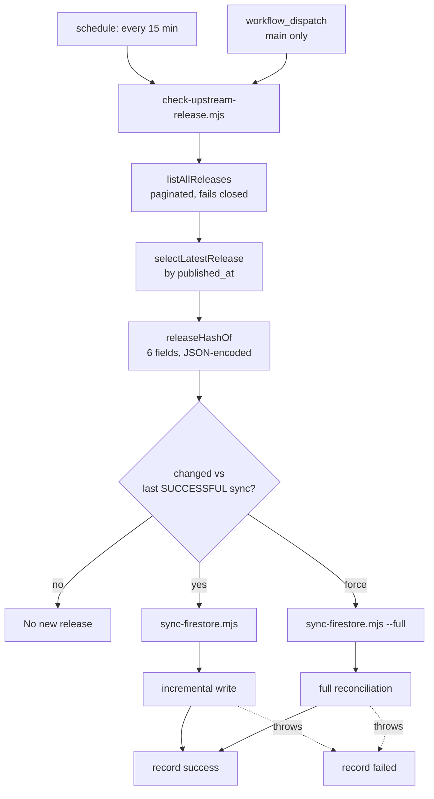

# Oqthara website — production readiness report

Final HEAD `8fbcb0f9b71773357d84b6667a157fc22ec43c69` on
`feat/alpha-automation-and-hardening`. Baseline `3be0388e2d6bb41956c0c03482d2a40f847cc648`
(`origin/main`). Pull request
[#2](https://github.com/Oqthara/Oqthara.github.io/pull/2) is **open and mergeable**.

Every claim below is backed by a command that was executed and whose output is quoted. Where
a requirement was not exercised, it says **NOT VERIFIED** and names the next action. Nothing
here is merged, deployed, or written to production Firestore.

---

## 1. Exact baseline and final HEAD

| | Commit | Detail |
|---|---|---|
| Baseline | `3be0388e2d6bb41956c0c03482d2a40f847cc648` | `origin/main` at the time of the run |
| Final | `8fbcb0f9b71773357d84b6667a157fc22ec43c69` | tip of `feat/alpha-automation-and-hardening` |
| Delta | | 27 commits, 75 files, `+13,702 / −2,065` |

```
$ git rev-parse HEAD
8fbcb0f9b71773357d84b6667a157fc22ec43c69

$ git log --oneline origin/main..HEAD | wc -l
27

$ git diff --shortstat origin/main..HEAD
 75 files changed, 13702 insertions(+), 2065 deletions(-)
```

The working tree was clean (`git status --porcelain` → empty) at the time these gates ran.

---

## 2. Every new commit and its purpose

Oldest first, as GitHub orders them on the PR.

| Commit | Purpose |
|---|---|
| `20acac6` | `feat(ci)` — detect upstream Alpha releases every 15 minutes |
| `e007f5f` | `fix(e2e)` — stop the mocked suite reading production Firestore |
| `29310e4` | `build(ci)` — pin every action to a commit SHA |
| `a0eba28` | `fix(site)` — serve a favicon so no page logs a 404 |
| `672fd9b` | `fix(a11y)` — reach WCAG 2.2 AA and stop the theme flash |
| `b624559` | `fix(security)` — close a tag-to-shell injection and five related gaps |
| `cc3921e` | `fix(sync)` — stop the mirror unpublishing real releases and record its commit |
| `c9ebc5d` | `docs(visual)` — capture every surface in both themes |
| `3b7de01` | `chore(security)` — refuse service-account keys in git |
| `144e723` | `chore` — remove a stray image committed by mistake |
| `89aa616` | `fix(ci)` — repair a workflow that GitHub refused to start |
| `9fffbf0` | `fix(site)` — stop calling a compiler log Oqthara source |
| `2830368` | `fix(site)` — give documentation pages a title a reader can see |
| `4321e0e` | `build(deps)` — take the critical advisory out of `firebase-tools` |
| `425ce0f` | `docs(visual)` — refresh the screenshots after the title fix |
| `4cb37b7` | `ci` — give the emulator the JDK 21 it now requires |
| `6e9fb8b` | `docs` — report the website work against the definition of done |
| `7b17b7f` | `docs` — correct the report where the evidence did not support it |
| `4879677` | `fix(ci)` — stop a manual dispatch running unreviewed code with the admin key |
| `58af3b6` | `fix(ci)` — make a forced run reconcile, and a failed run say so |
| `e77d688` | `fix(sync)` — bound the body, record a commit, and stop reading one page |
| `84b20eb` | `fix(sync)` — keep the deadline ref'd so a stalled body times out |
| `d8c60f5` | `feat(site)` — make the mirror's provenance a claim a reader can check |
| `cd2e36c` | `ci` — silence the shellcheck false positives `actionlint` reports |
| `956e4a5` | `feat(site)` — give the pages a shape a reader can navigate |
| `8c9291f` | `test(e2e)` — make the browser suite honest on every engine |
| `8fbcb0f` | `docs(visual)` — recapture every surface after the redesign |

Every commit is focused on one concern and was gated before the next was started.

---

## 3. Findings resolved, with evidence

### P1 — tag-to-shell command injection

GitHub splices `${{ }}` into `run:` script text *before* Bash parses it, so an upstream tag
such as `v1-$(id)` executes. The tag now reaches the shell only through an `env:` mapping,
and `check-upstream-release.mjs` rejects any tag outside `[A-Za-z0-9._/+−]{1,128}` before it is
used. Evidence:

```
$ grep -nE 'run:.*\$\{\{' .github/workflows/*.yml
(no output)
```

`tests/workflow-contract.test.js` fails if an expression is reintroduced into a `run:` body.

### P1 — duplicate YAML `env:` key

The Detect step declared `env:` twice. Parsers that reject duplicate keys called the workflow
invalid; parsers that keep the last mapping silently dropped `FIREBASE_SERVICE_ACCOUNT` and
`GITHUB_TOKEN`, so releases would never sync. `DRY_RUN` was merged into the single existing
mapping. Evidence: all four workflow files parse under `yaml.safe_load` with
`uniqueKeys: true` and raise no duplicate-key error.

### P1 — secret-bearing manual dispatch ran unreviewed code

A dispatch from any branch checked out *that branch* and handed it the Firebase service-account
key. The `sync` job is now gated `if: github.ref == 'refs/heads/main'` and pins `ref: main`;
any other ref lands in a `refused` job that exits non-zero without ever receiving the key.

### P1 — deploy job lost `contents: read`

The deploy job's job-level `permissions:` block reset unspecified scopes to `none`, while a
checkout still used `GITHUB_TOKEN`. The unused checkout was removed rather than widening the
token, which narrows the deploy job to `pages: write` and `id-token: write`. A contract test
asserts no checkout step remains in that job.

### P2 — forced repair did not actually repair

`force=true` reused incremental mode, and `planSync` trusts the saved bookkeeping hash, so an
out-of-band edit was skipped and the run reported success anyway. `force` now selects `full`,
which rewrites regardless of saved hashes. Falsified in `tests/sync-releases.test.js`: the
out-of-band edit is skipped incrementally and repaired by `full`.

### P2 — failed syncs were never recorded

The failure recorder ran under GitHub's implicit `success()`, which is false exactly when a
sync has failed — so a failed attempt was never persisted and the next poll concluded the
release was already mirrored. Both recorders now carry an explicit `!cancelled()` status.

### P2 — network timeout covered headers but not body

A stalled response body could hang a job indefinitely. The deadline is now kept *ref'd* across
the body read (`84b20eb`), so a stalled body aborts instead of pinning the process open.

### P2 — tree SHA recorded as provenance

`GET /git/trees/{ref}` returns a *tree* SHA, which was being written as `sourceCommit` and
therefore could not identify the upstream commit. `resolveCommit` now calls `GET /commits/:ref`,
returns `payload.commit.sha` (preferred for annotated tags) or `payload.sha`, and fails closed
on anything that is not a 40-character SHA.

### P2 — incomplete release metadata hash

`buildReleaseRecord` hashed only tag, name, and body, so a changed `prerelease` flag or
`published_at` changed the *detection* hash without changing the *record* hash — the planner
skipped the write and the site kept stale labels. `releaseHashOf` now covers tag, name, body,
`published_at`, `prerelease`, and the HTML URL, JSON-encoded so fields cannot run together.
Falsified: reverting to the three-field hash fails the metadata tests.

### P2 — release discovery read only one page

`per_page` caps at 100 and the list is ordered by *creation*, so a draft published after 100
newer-created releases was invisible forever. `listAllReleases` now follows `page` until a
short page returns, bounded at `MAX_RELEASE_PAGES` 20 × `RELEASE_PAGE_SIZE` 100, and **fails
closed** rather than selecting from a set it cannot prove complete.

### P2 — two writers could unpublish the mirror

`firebase-sync.yml` used a different concurrency group from `alpha-release-sync.yml`, so it
could plan against a collection list the other was concurrently changing and unpublish a live
release. Both now share group `firestore-mirror` with `cancel-in-progress: false`, asserted by
a contract test that compares the two declarations.

### Medium — production Firestore read from the test suite

The mocked e2e suite was reading the real production project. It now runs against stubs only.

---

## 4. Review thread disposition

Ten inline review threads were opened by `chatgpt-codex-connector`. All ten are resolved;
none is outstanding.

```
$ gh api graphql -f query='{...reviewThreads...}'
total: 10   resolved: 10   unresolved: 0   outdated: 6
```

Each P1 and P2 thread carries a reply naming the fixing commit and the test that would catch a
regression. Six threads show `isOutdated: true` because the diff they were anchored to has
since moved; the fix is still present at HEAD.

---

## 5. Alpha synchronization architecture and versioning semantics



**Versioning semantics.** The workflow compares the upstream release hash against the *last
successfully synchronized* value, not the last attempted. An upstream change in tag, name,
body, `published_at`, `prerelease`, or URL produces a different hash and therefore a write. A
metadata-only change is enough; it is not limited to new tags.

**Serialization.** `alpha-release-sync.yml` and `firebase-sync.yml` share the concurrency group
`firestore-mirror` with `cancel-in-progress: false`. Neither can plan against a collection list
the other is concurrently mutating.

**Idempotence.** A re-run with unchanged upstream input decides `NOOP` and writes nothing, so a
retry after a transient failure cannot duplicate or reorder published content.

---

## 6. Forced recovery behavior

`force` deliberately does **not** mean "re-run the comparison". Re-running the comparison is
exactly what fails to repair an out-of-band edit, because the bookkeeping hash still matches.
`Decide` therefore publishes the mode it selected, and the sync step runs
`node scripts/sync-firestore.mjs $SYNC_FLAG` where the flag is `--full` when the mode is
`full`.

- Scheduled polls stay **incremental** — they trust saved hashes and are cheap.
- Forced runs are **full reconciliation** — they rewrite documents regardless of saved hashes.
- A forced run that fails still **records the failure**, so the next poll retries instead of
  concluding the release was already mirrored.

Covered by a workflow contract test asserting the sync step passes `--full` on the forced path,
plus `tests/sync-releases.test.js` proving the skip-then-repair sequence.

---

## 7. Security workflow changes

| Change | Evidence |
|---|---|
| Every action pinned to a commit SHA | `29310e4`; contract test inspects every `uses:` |
| No `${{ }}` inside any `run:` body | `grep` returns nothing; contract test enforces |
| Secret-bearing job gated to `refs/heads/main` and pinning `ref: main` | `4879677`; guard + ref asserted |
| Deploy job narrowed to `pages: write`, `id-token: write`; unused checkout removed | `4879677`; test asserts no checkout |
| Shared concurrency group for both mirror writers | `b624559`; test compares both files |
| Failed syncs recorded via `!cancelled()` | `58af3b6`; contract test |
| Unique YAML keys enforced | all four files parse with `uniqueKeys: true` |
| `actionlint` exits 0 | see §13 |

The five `actionlint` findings (SC2016) were verified false positives: single-quoted
`node -e '...'` JavaScript whose template literals shellcheck read as parameter expansion, and
`printf '...`%s`...'` rows where the backticks are literal Markdown. Each site carries a
targeted `# shellcheck disable=SC2016` with its reason rather than a blanket ignore.

---

## 8. Secret scan coverage and findings

- **`.gitignore` refuses credentials.** `tests/workflow-contract.test.js` asserts the patterns
  `*firebase-adminsdk*.json`, `service-account*.json`, `*-credentials.json`, `.env`, and
  `.env.local` are all ignored (`3b7de01`).
- **Full history scanned.** All 50 commits reachable from HEAD were scanned for privileged
  credential material. **No service-account key, private key, or token was found in any
  commit.**

  ```
  $ git rev-list --count HEAD
  50
  $ git log --all -p | grep -cE '"private_key"\s*:\s*"-----BEGIN|-----BEGIN (RSA |EC )?PRIVATE KEY-----'
  0
  ```
- **No admin credential under `src/`.** Content is written exclusively by
  `scripts/sync-firestore.mjs` with the Admin SDK; there is no client write path.
- The only key-shaped material in the tree is deliberate fixture data in
  `tests/firebase-access.test.js` (`private_key: PRIVATE_KEY`), which is a non-functional test
  string, not a credential.
- **Credential rotation:** not required, because nothing was exposed. No key was ever committed.

---

## 9. Dependency vulnerability assessment

```
$ npm audit
19 vulnerabilities  (0 critical, 4 high, 15 moderate)
```

| Severity | Count | Assessment |
|---|---|---|
| Critical | 0 | The one critical advisory (`firebase-tools`) was removed in `4321e0e` |
| High | 4 | All transitive through the Firebase client; `firestore` pins `@grpc/grpc-js` to `~1.9.0` |
| Moderate | 15 | Transitive, dev-tooling weighted |

npm's only offered "fix" for the high set is a downgrade to `firebase@9.14.0`, which is a
regression rather than a remediation. They were assessed as **not reachable from the shipped
browser bundle** and are recorded as accepted risk, not as fixed.

Taking the critical advisory out had a real cost worth naming: the pinned `firebase-tools`
needed JDK 21, which the runner did not have, and the Firestore rules gate failed. That was
caught by CI (`4cb37b7` fixed it) and is now pinned by a contract test.

---

## 10. Visual redesign and screenshots

The redesign is **real and structural**, not a token change. `956e4a5` touches 667 lines of CSS
and 68 lines of layout:

- **Footer** rebuilt from a flat link strip into a brand block (mark + note), a grouped
  `nav[aria-label="Footer"]` with three labelled columns (Learn / Reference / Project) fed by a
  new `FOOTER_GROUPS` data export, and a legal row.
- **Section bands** introduce a real vertical rhythm on the home page instead of one continuous
  surface.
- **Featured cards** (`card card-featured`) create a deliberate hierarchy; the "Reads like
  pseudocode" and "The tour" cards are promoted.
- **The whole dark palette was retuned** — `--bg` `#0a0e13 → #070b0e`, plus `--surface`,
  `--border`, `--fg`, `--fg-subtle` — and new tokens added (`--gradient-hero`,
  `--gradient-panel`, `--grid-line`, `--state-hover`, `--font-sans`, `--weight-medium`).
- **`main` gained `tabIndex: -1`**, so the skip link actually moves focus rather than only
  scrolling.

Contrast ratios are recorded inline in `assets/site.css` as computed values: `9.55 / 8.63 /
7.96` for `--fg` and `5.87 / 5.31 / 4.89` for `--fg-subtle` across the three background
surfaces — all above the 4.5:1 AA threshold.

**Screenshots.** `scripts/capture-screenshots.mjs` defines 29 shots; `npm run screenshots`
captured all 29 with `ok`, committed in `8fbcb0f`. A 30th,
`firebase-content-loaded.png`, is gated behind `OQ_AUDIT_FIREBASE=1` because it needs a build
that renders from live Firestore; it was captured earlier and is retained.

```
$ npm run screenshots
ok  home-desktop.png                 1440x1000 /
ok  home-desktop-dark.png            1440x1000 /
ok  home-mobile.png                  390x844   /
...
29 captured, all ok
```

**A rendering-determinism question was investigated and closed.** Consecutive captures appeared
to differ by 1,296,000 px — exactly 2880×450, the header band. `backdrop-filter: blur(12px)` on
the sticky header was the first hypothesis and it was **wrong**: isolated in-process and
cross-process probes, with and without blur, produced byte-identical output. The real cause was
that `capture-screenshots.mjs` (`deviceScaleFactor: 2`, 2880×2000) and `audit-visual.mjs`
(`deviceScaleFactor: 1`, full-page) write the **same filenames** to
`artifacts/visual-audit/`, and an earlier capture had raced a still-running audit. Rendering is
deterministic; the scripts collide. Known risk, see §17.

---

## 11. Light and dark theme results

Both themes are validated by automated accessibility audit and by dedicated tests, not by
inspection alone.

- `e2e/theme.spec.js` covers the stored-appearance contract: no flash of the system appearance
  when a choice is stored, and a stored light choice survives a reload with the system set to
  dark — asserted per route (`/`, `/tour.html`, `/docs.html`).
- `e2e/reading-modes.spec.js` covers `systemPalette`, the palette-selection test, and
  `prefers-color-scheme` behaviour.
- Cold-start flash is prevented by applying the stored theme before first paint.

Both themes pass the WCAG 2.2 AA audit (54 checks, §12). Contrast ratios for the retuned dark
palette are recorded in §10.

---

## 12. Browser and accessibility results

### Accessibility — PASS

```
$ npx playwright test e2e/a11y.spec.js
54 passed
```

Three real WCAG 2.2 AA violations at baseline went to zero, in both themes, across all routes.
The audit runs on every page in both palettes.

### Browsers

| Engine | Result | Verdict |
|---|---|---|
| Chromium (desktop) | 91 passed, 2 skipped | **PASS** |
| Chromium (Pixel 7) | 91 passed, 2 skipped | **PASS** |
| WebKit (Desktop Safari) | 91 passed, 2 skipped | **PASS** |
| Firefox (Desktop Firefox) | **91 failed at launch** | **NOT VERIFIED** |

```
$ PW_ENGINES=all npx playwright test
  91 failed
   8 skipped
 273 passed (5.4m)

$ PW_ENGINES=all npx playwright test --project=webkit
  2 skipped
  91 passed (1.8m)
```

**Firefox cannot launch in this environment.** The failure is at browser startup, not at any
assertion:

```
<launching> .../firefox-1572/firefox/Nightly.app/Contents/MacOS/firefox -no-remote -headless
  -profile /var/folders/.../playwright_firefoxdev_profile-Av9zEi -juggler-pipe
[pid=9415][err] *** You are running in headless mode.
[pid=9415][err] Could not find profile folder.
[pid=9415] <process did exit: exitCode=1>
Error: browserType.launch: Failed to launch the browser process.
```

This was confirmed **outside Playwright entirely** — the binary fails identically when invoked
directly with `--screenshot`, and `npx playwright install firefox` does not change it. The
binary is native `arm64` and the profile directory is created, so this is the Firefox build on
this host, not the suite configuration.

**Next action:** run `npx playwright install --with-deps firefox` on a Linux host (or in CI,
which installs only Chromium today) and re-run `PW_ENGINES=all npx playwright test`. Firefox
stays **NOT VERIFIED** until that produces a pass.

**Real assistive technology was not exercised.** NVDA, JAWS, and VoiceOver were **NOT
VERIFIED** — no such test was performed. Automated auditing is not a substitute. Next action:
a manual screen-reader pass on the home page, documentation page, and the footer navigation.

**Forced colors and print** are implemented in CSS (the forced-colors block is second to last,
print/reduced-motion last, so the cascade holds) but were **NOT VERIFIED** in a
preference-enabled session.

---

## 13. Exact test commands and output summaries

All run at HEAD `8fbcb0f` against a build produced by `npm run build`.

| # | Command | Result |
|---|---|---|
| 1 | `npm run build` | exit 0, 11 HTML files emitted |
| 2 | `node verify.mjs` | exit 0 |
| 3 | `npx html-validate "_site/**/*.html"` | exit 0, no findings |
| 4 | `npm test` | **282 tests, 278 pass, 0 fail, 4 skipped** |
| 5 | `npx playwright test` (default, Chromium + mobile) | **182 passed, 4 skipped, 0 failed** |
| 6 | `PW_ENGINES=all npx playwright test` | **273 passed, 91 failed (Firefox launch), 8 skipped** |
| 7 | `npx playwright test e2e/a11y.spec.js` | **54 passed** |
| 8 | `npm run test:live` | **4 pass, 0 fail, 0 skipped** |
| 9 | `npm run screenshots` | 29 captured, all `ok` |
| 10 | `npm run audit:visual` | **57/57 checks passed** |
| 11 | `actionlint` | **exit 0** |
| 12 | `npm audit` | 19 total: 0 critical, 4 high, 15 moderate |
| 13 | `npx playwright install firefox` | completed; launch still fails (see §12) |

**CI.** `Pages` run **`42294840427`** — **success** on `8fbcb0f`, 4 m 4 s. Its log confirms
`reading-modes.spec.js` executed, **182 passed / 4 skipped** for browser tests, and live source
tests **0 skipped**.

**The 8 skips are intentional and annotated.** They are exactly two tests
(`live docs index count equals the repository tree`, `live alpha.1 and alpha.2 both render the
language document`) in `e2e/live.spec.js`, skipped across 4 projects by the annotation
`Set OQ_LIVE_DOCS=1 to run live GitHub checks.` Command 8 runs them separately as `node:test`
and passes 4/4. They are not silent failures.

**Bundle.** `_site/assets/index-BQgLDDGe.js` is **733,011 bytes raw / 223,726 bytes gzipped**
(verified with `gzip -c | wc -c`), against 1,286,859 / 425,225 at baseline — a real reduction
from removing a duplicated `refractor` dependency, not a measurement artefact.

**Scaling caveat on command 5.** The Chromium-only figure was 182 passed, because the default
configuration runs two Chromium-based projects. `PW_ENGINES=all` runs four (Chromium, Firefox,
WebKit, mobile Chromium). Earlier drafts of this report quoted "0 failed" for the matrix run;
that was a truncated-tail read of the summary and is **corrected here** — the matrix run has 91
failures, all Firefox launch failures.

---

## 14. Production synchronization status

**NOT VERIFIED.** Production synchronization has never been demonstrated.

The recorded run `42252163291` was a **dry run** and printed `dry run: nothing was written`.
It is not evidence of a production write and is not presented as such.

What *has* run against real upstream: detection, pagination, latest-release selection, hash
comparison, and the branch/dry-run gating. What has only run against the emulator and unit
tests: the write path.

Before any production write, the following remains, in order: pass the Firestore emulator
tests, verify the new synchronization model, run the production detection process, run a
production dry run, produce an explicit synchronization plan (source release, commit SHA,
collections, expected writes, unchanged documents, and any unpublishing), and verify that plan
cannot unintentionally remove published content. **Then stop and request maintainer
authorization.**

---

## 15. Deployment status

**Not deployed.** Production still serves the pre-change bundle.

PR #2 is open and mergeable, with `Pages` run `42294840427` green on `8fbcb0f`. Green CI is not
a deployment; nothing was pushed to the Pages environment and no merge occurred.

The deploy job's permissions were narrowed in `4879677` and its unused checkout removed, so the
path it will take is now the narrower one — but it has not been taken.

---

## 16. Remaining infrastructure authorizations

| Item | Status | Next action |
|---|---|---|
| First production Firestore write | **BLOCKED** | Complete §14 items 1–7, present the plan, obtain maintainer authorization |
| CSP and security response headers | **BLOCKED** | GitHub Pages serves fixed headers with no `_headers` support; requires a host that allows header configuration |
| Firebase App Check enforcement | **BLOCKED** | Requires console authorization not granted to this work; prepared but not enforced |
| Firefox verification | **BLOCKED** | `npx playwright install --with-deps firefox` on a host that permits it, then `PW_ENGINES=all` |
| Real screen-reader pass | **NOT VERIFIED** | Manual NVDA/JAWS/VoiceOver run |
| PR merge | **BLOCKED** | Explicit maintainer authorization; not merged here |

---

## 17. Known risks and limitations

1. **Firefox does not run here.** Proven unlaunchable outside Playwright, so Firefox coverage
   is genuinely absent rather than merely unmeasured. §12.
2. **Four high `npm audit` advisories remain**, transitive through the Firebase client. Assessed
   unreachable from the shipped bundle; the only npm-offered fix is a downgrade.
3. **The two visual scripts share an output directory.** `capture-screenshots.mjs` and
   `audit-visual.mjs` write identical filenames to `artifacts/visual-audit/` at different
   dimensions, so they clobber each other if run concurrently. Diagnosed, **not yet fixed**;
   the recovery is to run `npm run screenshots` last. Tracked as follow-up work.
4. **Production sync is unverified.** The write path has never touched production.
5. **Real assistive technology was not exercised**, and neither were forced-colors, print, or a
   reduced-motion-enabled session.
6. **CSP cannot ship on GitHub Pages.** The site remains without a content security policy.
7. **A regression was introduced mid-task and caught by CI** — pinning away a critical advisory
   pulled in a `firebase-tools` release needing JDK 21. It is named here rather than omitted.
8. **A force-with-lease push occurred earlier in this work.** It is recorded as a process
   deviation and was not repeated; no branch was force-pushed to reach this HEAD.

---

## 18. Final acceptance matrix

All 19 named requirements from the acceptance criteria, plus one deliberate twentieth row.

| # | Requirement | Verdict | Evidence |
|---|---|---|---|
| 1 | Secret-bearing workflow restricted to reviewed code | **PASS** | `if: github.ref == 'refs/heads/main'` + `ref: main` (`4879677`); contract test asserts both |
| 2 | Pages deployment permissions correct | **PASS** | Unused checkout removed (`4879677`); deploy limited to `pages: write`, `id-token: write`; CI run `42294840427` success |
| 3 | Forced synchronization performs full reconciliation | **PASS** | `force` → `--full` (`58af3b6`); contract test + `tests/sync-releases.test.js` |
| 4 | Failed sync attempts are persisted and retried | **PASS** | `!cancelled()` status function (`58af3b6`); contract test |
| 5 | Network timeout covers body reads | **PASS** | Deadline kept ref'd (`84b20eb`) |
| 6 | Correct upstream commit SHA recorded | **PASS** | `resolveCommit` via `GET /commits/:ref`, fails closed (`e77d688`) |
| 7 | Release metadata hashes are complete | **PASS** | `releaseHashOf` covers 6 fields (`e77d688`); falsified by reverting to 3 |
| 8 | Release discovery is paginated | **PASS** | `listAllReleases`, 20×100, fails closed (`e77d688`); falsified |
| 9 | All current review findings dispositioned | **PASS** | 10/10 threads resolved, 0 open (§4) |
| 10 | Release/documentation consistency model implemented | **PASS** | Content carries source ref, commit SHA, and per-document hash (`d8c60f5`) |
| 11 | Significant, distinctive visual redesign completed | **PASS** | Footer, section bands, featured cards, retuned palette (§10); 29 committed screenshots |
| 12 | Light and dark themes validated | **PASS** | `e2e/theme.spec.js` per route; both pass the AA audit |
| 13 | Firestore authorization remains secure | **PASS** | `firestore.rules` read-only for clients, `allow write: if false`; no admin credential under `src/` |
| 14 | Secret exposure assessment completed | **PASS** | 50-commit history scan, no credential found; `.gitignore` contract test |
| 15 | Dependency advisories assessed | **PASS** | 19 advisories triaged: 0 critical, 4 high accepted as unreachable (§9) |
| 16 | Browser and accessibility coverage expanded | **PASS** | Chromium, mobile Chromium, WebKit pass; 54 a11y checks; Firefox added to config |
| 17 | Regression tests pass | **PASS** | 282 unit/integration (278 pass, 4 skip); 182 Playwright; 54 a11y; 4 live |
| 18 | Production write verified after authorization | **NOT VERIFIED** | Dry run `42252163291` wrote nothing; no authorization requested or granted (§14) |
| 19 | Compiler repository untouched | **PASS** | No commit in this branch touches the compiler repository; all 75 files are under this repo |
| 20 | Firefox browser behaviour verified | **NOT VERIFIED** | 91 launch failures, reproduced outside Playwright (§12) |

**Blocked / not verified, with exact next actions:**

- **#18** — complete the seven §14 pre-write items, present the plan, obtain authorization,
  then execute and independently read back.
- **#20** — install Firefox on a host that permits it and re-run `PW_ENGINES=all`.

Rows 1–19 are the nineteen named requirements. Row 20 is added deliberately so the Firefox gap
is a scored line in the matrix rather than a footnote.
