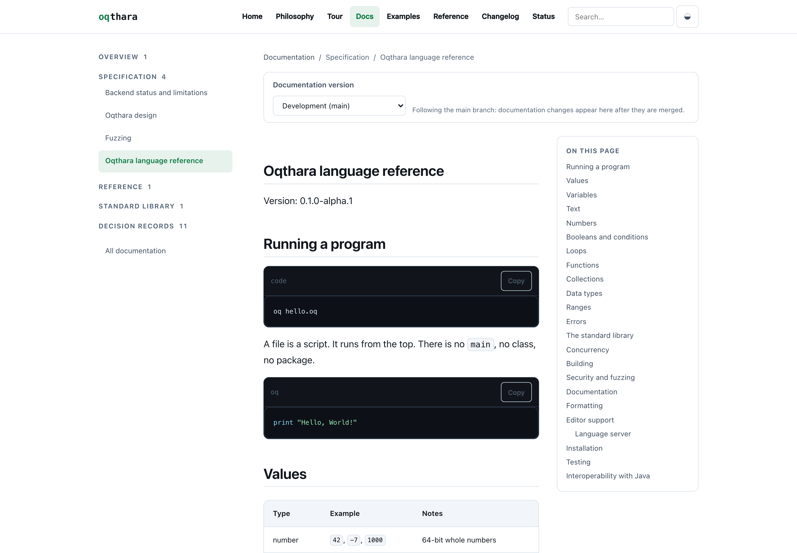

# Visual review package — PR #2

This file exists so a human can judge the rendered pages. Aesthetic acceptance was
**NOT VERIFIED** while the package was prepared; the maintainer then reviewed it and recorded
**APPROVED** in §6 on 2026-11-07.

## 1. What is under review

| Fact | Value |
| --- | --- |
| Repository | `Oqthara/Oqthara.github.io` |
| Pull request | [#2](https://github.com/Oqthara/Oqthara.github.io/pull/2) |
| Branch | `feat/alpha-automation-and-hardening` |
| Branch HEAD when the captures were made | `e43d418` |
| Merge state | **merged into `main` as `9d9a41a`**, by the maintainer, after the captures |
| Commit under review | `9d9a41a` — the squash of this branch, and what the links below resolve against |
| Screenshots captured in | `4ed134a` — 29 files captured, 17 of them changed; 1 of the 30 was not in the run (§5 V1) |
| Screenshot count | 30 files, 30 tracked, 0 duplicates |

**Gallery:** https://github.com/Oqthara/Oqthara.github.io/tree/main/artifacts/visual-audit

Every image below is linked individually against `main`. GitHub renders PNGs in the browser,
so the links open the actual pixels. All 30 files are byte-identical between `e43d418` and
`main`, so which of the two is used does not change what a reviewer sees.

## 2. Inventory

Dimensions are the real PNG pixel dimensions, read from each file header, with the CSS
viewport they correspond to. Captures use `deviceScaleFactor: 2`, so a 1440×1000 CSS
viewport is stored as 2880×2000 pixels — the doubled numbers are not a different viewport.

Theme is not taken from the filename. Each file was decoded and its mean luminance
measured; a mean below 90/255 is recorded as dark. All 30 filenames agree with their own
pixels — the recorded theme is a measurement, not a restatement of the name.

What that check cannot see is *age*. It classifies `firebase-content-loaded.png` as light,
correctly, while the image still shows a retired palette. Age was caught by reading its
background colour instead: pure `#ffffff` against `#fbfaf7` on every other light page (§5).

| # | File | Page | Viewport | Theme | Pixels | CSS | Size |
| --- | --- | --- | --- | --- | --- | --- | --- |
| 1 | [`home-desktop.png`](https://github.com/Oqthara/Oqthara.github.io/blob/main/artifacts/visual-audit/home-desktop.png) | / | desktop | light | 2880×2000 | 1440×1000 | 518.9 KB |
| 2 | [`home-desktop-dark.png`](https://github.com/Oqthara/Oqthara.github.io/blob/main/artifacts/visual-audit/home-desktop-dark.png) | / | desktop | dark | 2880×2000 | 1440×1000 | 540.8 KB |
| 3 | [`home-mobile.png`](https://github.com/Oqthara/Oqthara.github.io/blob/main/artifacts/visual-audit/home-mobile.png) | / | mobile | light | 780×1688 | 390×844 | 267.2 KB |
| 4 | [`home-mobile-dark.png`](https://github.com/Oqthara/Oqthara.github.io/blob/main/artifacts/visual-audit/home-mobile-dark.png) | / | mobile | dark | 780×1688 | 390×844 | 311.7 KB |
| 5 | [`navigation-mobile-open.png`](https://github.com/Oqthara/Oqthara.github.io/blob/main/artifacts/visual-audit/navigation-mobile-open.png) | / (menu expanded) | mobile | light | 780×1688 | 390×844 | 82.7 KB |
| 6 | [`navigation-mobile-open-dark.png`](https://github.com/Oqthara/Oqthara.github.io/blob/main/artifacts/visual-audit/navigation-mobile-open-dark.png) | / (menu expanded) | mobile | dark | 780×1688 | 390×844 | 77.2 KB |
| 7 | [`docs-desktop.png`](https://github.com/Oqthara/Oqthara.github.io/blob/main/artifacts/visual-audit/docs-desktop.png) | /docs.html | desktop | light | 2880×2000 | 1440×1000 | 234.8 KB |
| 8 | [`docs-desktop-dark.png`](https://github.com/Oqthara/Oqthara.github.io/blob/main/artifacts/visual-audit/docs-desktop-dark.png) | /docs.html | desktop | dark | 2880×2000 | 1440×1000 | 235.1 KB |
| 9 | [`docs-mobile.png`](https://github.com/Oqthara/Oqthara.github.io/blob/main/artifacts/visual-audit/docs-mobile.png) | /docs.html | mobile | light | 780×1688 | 390×844 | 150.7 KB |
| 10 | [`docs-mobile-dark.png`](https://github.com/Oqthara/Oqthara.github.io/blob/main/artifacts/visual-audit/docs-mobile-dark.png) | /docs.html | mobile | dark | 780×1688 | 390×844 | 151.6 KB |
| 11 | [`doc-page-code-highlighting.png`](https://github.com/Oqthara/Oqthara.github.io/blob/main/artifacts/visual-audit/doc-page-code-highlighting.png) | /document.html?path=docs/spec/language.md | desktop | light | 2880×2000 | 1440×1000 | 294.2 KB |
| 12 | [`doc-page-code-highlighting-dark.png`](https://github.com/Oqthara/Oqthara.github.io/blob/main/artifacts/visual-audit/doc-page-code-highlighting-dark.png) | /document.html?path=docs/spec/language.md | desktop | dark | 2880×2000 | 1440×1000 | 293.7 KB |
| 13 | [`doc-page-mobile.png`](https://github.com/Oqthara/Oqthara.github.io/blob/main/artifacts/visual-audit/doc-page-mobile.png) | /document.html?path=docs/spec/language.md | mobile | light | 780×1688 | 390×844 | 107.2 KB |
| 14 | [`doc-page-mobile-dark.png`](https://github.com/Oqthara/Oqthara.github.io/blob/main/artifacts/visual-audit/doc-page-mobile-dark.png) | /document.html?path=docs/spec/language.md | mobile | dark | 780×1688 | 390×844 | 106.8 KB |
| 15 | [`examples-desktop.png`](https://github.com/Oqthara/Oqthara.github.io/blob/main/artifacts/visual-audit/examples-desktop.png) | /examples.html | desktop | light | 2880×2000 | 1440×1000 | 252.3 KB |
| 16 | [`examples-desktop-dark.png`](https://github.com/Oqthara/Oqthara.github.io/blob/main/artifacts/visual-audit/examples-desktop-dark.png) | /examples.html | desktop | dark | 2880×2000 | 1440×1000 | 252.7 KB |
| 17 | [`example-desktop.png`](https://github.com/Oqthara/Oqthara.github.io/blob/main/artifacts/visual-audit/example-desktop.png) | /example.html?path=examples/anagrams.oq | desktop | light | 2880×2000 | 1440×1000 | 216.7 KB |
| 18 | [`example-desktop-dark.png`](https://github.com/Oqthara/Oqthara.github.io/blob/main/artifacts/visual-audit/example-desktop-dark.png) | /example.html?path=examples/anagrams.oq | desktop | dark | 2880×2000 | 1440×1000 | 215.7 KB |
| 19 | [`stdlib-desktop.png`](https://github.com/Oqthara/Oqthara.github.io/blob/main/artifacts/visual-audit/stdlib-desktop.png) | /stdlib.html | desktop | light | 2880×2000 | 1440×1000 | 276.2 KB |
| 20 | [`stdlib-desktop-dark.png`](https://github.com/Oqthara/Oqthara.github.io/blob/main/artifacts/visual-audit/stdlib-desktop-dark.png) | /stdlib.html | desktop | dark | 2880×2000 | 1440×1000 | 276 KB |
| 21 | [`changelog-desktop.png`](https://github.com/Oqthara/Oqthara.github.io/blob/main/artifacts/visual-audit/changelog-desktop.png) | /changelog.html | desktop | light | 2880×2000 | 1440×1000 | 287.2 KB |
| 22 | [`changelog-desktop-dark.png`](https://github.com/Oqthara/Oqthara.github.io/blob/main/artifacts/visual-audit/changelog-desktop-dark.png) | /changelog.html | desktop | dark | 2880×2000 | 1440×1000 | 288.2 KB |
| 23 | [`status-desktop.png`](https://github.com/Oqthara/Oqthara.github.io/blob/main/artifacts/visual-audit/status-desktop.png) | /status.html | desktop | light | 2880×2000 | 1440×1000 | 290.3 KB |
| 24 | [`status-desktop-dark.png`](https://github.com/Oqthara/Oqthara.github.io/blob/main/artifacts/visual-audit/status-desktop-dark.png) | /status.html | desktop | dark | 2880×2000 | 1440×1000 | 292 KB |
| 25 | [`philosophy-desktop.png`](https://github.com/Oqthara/Oqthara.github.io/blob/main/artifacts/visual-audit/philosophy-desktop.png) | /philosophy.html | desktop | light | 2880×2000 | 1440×1000 | 325.4 KB |
| 26 | [`philosophy-desktop-dark.png`](https://github.com/Oqthara/Oqthara.github.io/blob/main/artifacts/visual-audit/philosophy-desktop-dark.png) | /philosophy.html | desktop | dark | 2880×2000 | 1440×1000 | 329.5 KB |
| 27 | [`tour-desktop.png`](https://github.com/Oqthara/Oqthara.github.io/blob/main/artifacts/visual-audit/tour-desktop.png) | /tour.html | desktop | light | 2880×2000 | 1440×1000 | 278.4 KB |
| 28 | [`tour-desktop-dark.png`](https://github.com/Oqthara/Oqthara.github.io/blob/main/artifacts/visual-audit/tour-desktop-dark.png) | /tour.html | desktop | dark | 2880×2000 | 1440×1000 | 277.6 KB |
| 29 | [`not-found-desktop.png`](https://github.com/Oqthara/Oqthara.github.io/blob/main/artifacts/visual-audit/not-found-desktop.png) | /no-such-page.html | desktop | light | 2880×2000 | 1440×1000 | 231.5 KB |
| 30 | [`firebase-content-loaded.png`](https://github.com/Oqthara/Oqthara.github.io/blob/main/artifacts/visual-audit/firebase-content-loaded.png) | /document.html?path=docs/spec/language.md (emulator build) | desktop | light | 2880×2000 | 1440×1000 | 281.7 KB |

**30 files across 13 page groups.** Viewports present: **desktop 1440×1000** (22 captures)
and **mobile 390×844** (8 captures). See §5 for the tablet gap.

## 3. Recommended inspection order

Judge the whole before the parts. A page can pass every per-element check and still look
wrong, so the first pass is impression only — no measuring, no counting.

| Pass | Look at | Question to answer |
| --- | --- | --- |
| 1. Impression | `home-desktop` then `home-desktop-dark` | Does this look like a site someone designed on purpose? |
| 2. Theme parity | Any light/dark pair, side by side | Does dark feel like the same design, or a second one? |
| 3. Reading | `doc-page-code-highlighting`, `philosophy-desktop`, `stdlib-desktop` | Can you read a paragraph without effort? |
| 4. Density | `stdlib-desktop`, `changelog-desktop` | Does volume break the rhythm or hold it? |
| 5. Narrow measure | `status-desktop` | Does 568px look deliberate in a wide column, or stranded? |
| 6. Rail geometry | `tour-desktop` | Do the prose and its contents rail read as one unit? |
| 7. Code | `doc-page-code-highlighting` (both), `example-desktop` | Are tokens distinguishable and is code legible? |
| 8. Mobile | `home-mobile`, `docs-mobile`, `doc-page-mobile` (both themes) | Does anything overflow, clip, or crowd? |
| 9. Navigation | `navigation-mobile-open` (both) | Are targets hittable and labels readable? |
| 10. Edge states | `not-found-desktop`, `status-desktop` | Do error and degraded states still look designed? |

## 4. Checklist

Tick these against the images, not against this document. Each is a judgement call that
automation cannot make.

### Visual hierarchy

- [ ] Each page has one obvious focal point.
- [ ] Heading levels are distinguishable without reading the words.
- [ ] Interface type (nav, buttons, labels) is distinguishable from editorial type.
- [ ] Nothing competes with the primary action or the page title.

### Typography and readability

- [ ] Body text is comfortable, not merely legible.
- [ ] Line length invites reading rather than tracking back.
- [ ] Leading is generous enough that lines do not merge.
- [ ] Code is clearly monospace and clearly smaller than prose, but not squinting-small.
- [ ] Inline code sits on the baseline rather than disrupting it.

### Spacing and alignment

- [ ] Vertical rhythm is consistent between sections.
- [ ] Related items are visibly closer than unrelated ones.
- [ ] Left edges align across elements that should share an axis.
- [ ] No gap looks accidental, and no gap looks like a mistake left in.

### Colour and contrast

- [ ] Text is comfortable to read, not merely above the AA threshold.
- [ ] Borders and dividers are visible but not loud.
- [ ] The accent is used sparingly enough to still mean something.
- [ ] Syntax colours are distinguishable from each other, not just from the background.

### Theme consistency

- [ ] Dark is a translation of light, not a different design.
- [ ] Elevation is expressed in dark without relying on shadow alone.
- [ ] Images, badges and code plates do not glow or disappear in dark.
- [ ] Contrast holds in both directions.

### Responsive behaviour

- [ ] Nothing overflows horizontally at 390px.
- [ ] Text does not clip or truncate unexpectedly.
- [ ] Tap targets are comfortably hittable.
- [ ] The mobile layout is a composition, not a collapsed desktop.

### Navigation and footer

- [ ] The open mobile menu is clearly distinct from the page behind it.
- [ ] Labels are readable at menu size.
- [ ] Footer grouping reads as structure, not a link dump.

### Coherence

- [ ] Header, footer and body look like one system.
- [ ] Cards, notes, badges and buttons share a consistent shape language.
- [ ] The 404 page belongs to the same site as the homepage.

## 5. Findings from preparing this package

Two problems were found while verifying the artifacts. Neither is an aesthetic judgement,
and neither was fixed here — §5 of the execution order says defects get handled once a
maintainer confirms them.

### V1 — `firebase-content-loaded.png` is stale, and cannot be regenerated as it stands

This image is **not** part of the current design. It was captured in `4a96c30`
(2026-11-06) and was not among the 17 files recaptured in `4ed134a`. Eight commits have
touched `assets/site.css` since, including the whole token-wiring pass and the
reading-measure fix.

The evidence is in the pixels, not in the timestamps. Its page background measures pure
`#ffffff`; every other light capture in the set measures `#fbfaf7`, which is the value
`--bg` has had since `956e4a5`. At `4a96c30` the light `--bg` was literally `#ffffff`, so
the image is a faithful capture of a palette the site no longer uses.

It also cannot currently be regenerated. Its `SHOTS` entry declares no `theme`, and the
capture loop now ends with a hard assertion:

```js
const applied = await page.locator("[data-theme-state]").first().getAttribute("data-theme-state");
if (applied !== shot.theme) {
  throw new Error(`expected the ${shot.theme} theme, but the toggle reported ${applied}`);
}
```

With `shot.theme` undefined, `applied` resolves to `"auto"` and this throws. Recapturing
needs `OQ_AUDIT_FIREBASE=1` against an emulator-seeded build **and** a `theme` value added
to that entry. Neither is done here.



**Effect on this review:** the 29 ordinary captures are current. This one is historical. Do
not judge the current design from it. Whether to recapture or drop it is a maintainer
decision, and it is the one item in this package that does not meet §2.3 of the execution
order ("verify they belong to the latest capture commit") for all 30 files.

### V2 — no tablet captures exist

The execution order asks for grouping by desktop, tablet and mobile "where applicable". No
tablet viewport is captured: the script defines exactly two, `DESKTOP` 1440×1000 and
`MOBILE` 390×844, and the files confirm it — 22 captures at 2880×2000 and 8 at 780×1688,
with no third size. This is a gap in the artifact set, not a wrong filename.

Responsive behaviour between 390 and 1440 is therefore **not covered by these images**. It
is covered by `npm run audit:visual`, which runs 11 routes across five viewports including
768px and checks for overflow programmatically — but that measures geometry, not looks.

### Distinction from the collision guard

Neither finding is the screenshot-collision defect. That guard is intact: the audit writes
to `artifacts/visual-audit-routes/`, the committed set stays in `artifacts/visual-audit/`,
and `tests/site.test.js` fails if the two paths converge. V1 and V2 are about whether the
committed images are current and complete, which nothing currently tests.

## 6. Maintainer decision

**Status: APPROVED.**

| Field | Value |
| --- | --- |
| Decision | **APPROVED** |
| Reviewer | the repository maintainer (`@Oqthara`), in the review conversation |
| Date | 2026-11-07, 11:14 -03:00 (14:14Z) |
| Images inspected | not stated. The maintainer replied `APPROVED` to a direct request for one of APPROVED / APPROVED WITH RESERVATIONS / REJECTED, without enumerating what was opened |
| Reservations | none recorded |

The decision is recorded verbatim. This file does not claim the maintainer opened all 30
images, or any particular subset — that was not stated, and inventing it would make the
record less trustworthy than the one-word answer it came from.

Before the decision, this section said NOT VERIFIED, because no amount of evidence generated
by the agent preparing the package substitutes for a person looking at the pixels. Capture
success, byte-identical reruns, geometry assertions, contrast ratios and browser results all
show the site renders as specified; none of them show that it looks right. The maintainer
supplied exactly the judgement the tooling could not.

### What the approval does not settle

Approval was given as `APPROVED`, not `APPROVED WITH RESERVATIONS`. That is a decision that
the visuals are acceptable, and it is not a decision to close the two findings in §5. Neither
was raised as a blocking reservation, so both stay open as ordinary follow-up work:

| Finding | Still true? | Consequence |
| --- | --- | --- |
| V1 — stale `firebase-content-loaded.png` | yes | One of 30 committed images shows a retired palette. It is not evidence of the current design, and it cannot be regenerated as it stands. |
| V2 — no tablet captures | yes | Behaviour at 768px has geometry coverage but no visual record. |

Neither is a defect in the shipped site. V1 is a stale artifact, V2 is a gap in the image
set, so approving the visuals neither resolves nor is blocked by them. Closing them is
separate work: V1 needs a `theme` value added to its `SHOTS` entry plus an emulator-seeded
build, or the entry and file dropped; V2 needs a third viewport added to
`scripts/capture-screenshots.mjs` and a recapture.

**Neither is authorized by this file.** This package performs no production write, no merge
and no deploy.

### What was disclosed before the decision

These were on the record when the maintainer approved, so the approval covers them as
accepted-by-omission rather than as unseen surprises. V1 and V2 are detailed above; the
last four are judgement calls a reviewer could reasonably have rejected.

| Item | Why it matters |
| --- | --- |
| V1: stale `firebase-content-loaded.png` | One of 30 images shows a retired palette. Judging it as current would be wrong. |
| V2: no tablet captures | Behaviour at 768px has geometry coverage but no visual evidence. |
| Narrow measure on `/status.html` | Deliberately kept at 568px with no narrower token. A reviewer may disagree. |
| Tour rail geometry | Reproduced by an explicit `max-width` cap rather than inherited nesting; the numbers match, the structure differs. |
| Firefox | Not launchable on the review host. CI runs it green on Linux. |
| Typography and spacing scope | The whole point of the branch. Approval says the scale reads correctly, not that every page was measured against every token. |

## 7. What visual approval does not authorize

Approving the visuals is a statement about how the site looks. It is not a release
authorization, and it does not unlock the blocked data work.

| Gate | State | Who can open it |
| --- | --- | --- |
| `OQTHARA_PRODUCTION_SYNC` | **unset — writes disabled** | maintainer, in repository settings |
| `OQTHARA_DEPLOY_FIRESTORE_RULES` | **unset — deploys disabled** | maintainer, in repository settings |
| Production Firestore writes | **NOT PERFORMED by this branch's tooling** | maintainer authorization required, separately |
| Document-level reconciliation plan | **NOT APPROVED** | maintainer review, separately |
| Merge of PR #2 | **DONE — merged by the maintainer as `9d9a41a`** | already happened, outside this review |
| Deploy | **DONE — GitHub Pages deployed `9d9a41a`** | already happened, outside this review |

The last two rows were false when this package was drafted and are corrected here. While the
review package was being assembled, the maintainer merged PR #2 (2026-11-07T13:55:59Z) and
the Pages workflow deployed the merge commit; `https://oqthara.github.io/` answers `200` and
serves the new palette (`--bg:#fbfaf7` light, `#070b0e` dark). Nothing in this branch did
either of those things, and no gate below was opened by the review.

Visual approval does not change the remaining rows:

- It does not authorize writing production records, and it opens no variable. Both activation
  variables remain unset, and `firebase-sync.yml` on `main` still runs its write step only
  when `steps.gate.outputs.enabled == 'true'`.
- **One correction to earlier reporting:** production reads are not currently blocked. When
  this package was drafted the data plane returned `429 RESOURCE_EXHAUSTED`, but a scheduled
  run afterwards read production successfully. Its log reports `read 59 source records` from
  GitHub and then `skip 59 unchanged` — and a record can only be classified unchanged by
  comparing its `contentHash` against the stored document, which means all 59 Firestore
  documents were read from the `oqthara` project. A fresh unauthenticated probe now answers
  `403`, not `429`. So the state *can* be read; what remains outstanding is the
  document-level reconciliation plan, which is still unapproved.
- It does not make the credential-free dry run meaningful. That run has no credential, sees
  an empty mirror, and reports a plan that understates the change by the entire dataset.

## 8. How this package was verified

| Check | Command or method | Result |
| --- | --- | --- |
| Branch HEAD | `git rev-parse --short HEAD` | `e43d418`, clean tree |
| PR head matches | `gh pr view 2 --json headRefOid` | `e43d418` |
| Screenshot commit | `git log -1 -- artifacts/visual-audit/` | `4ed134a` |
| 30 files present | `ls artifacts/visual-audit/*.png \| wc -l` | 30 |
| Tracked vs working tree | `diff` of `git ls-files` against `ls` | identical |
| Duplicate content | `shasum -a 256 \| uniq -d` | 0 duplicates |
| Filename collisions | case-folded `uniq -d` | 0 |
| Real dimensions | PNG IHDR read from each file | 22 at 2880×2000, 8 at 780×1688 |
| Theme per file | decoded pixels, mean luminance | 14 dark, 16 light; all 29 themed captures agree with their filenames. The 16th light is `firebase-content-loaded.png`, whose `#ffffff` background is the V1 outlier |
| GitHub reachability | `curl -I` on all 30 raw URLs | 30/30 HTTP 200 |
| Collision guard intact | `node --test tests/site.test.js` | pass |

Nothing in the table above is an aesthetic judgement.
